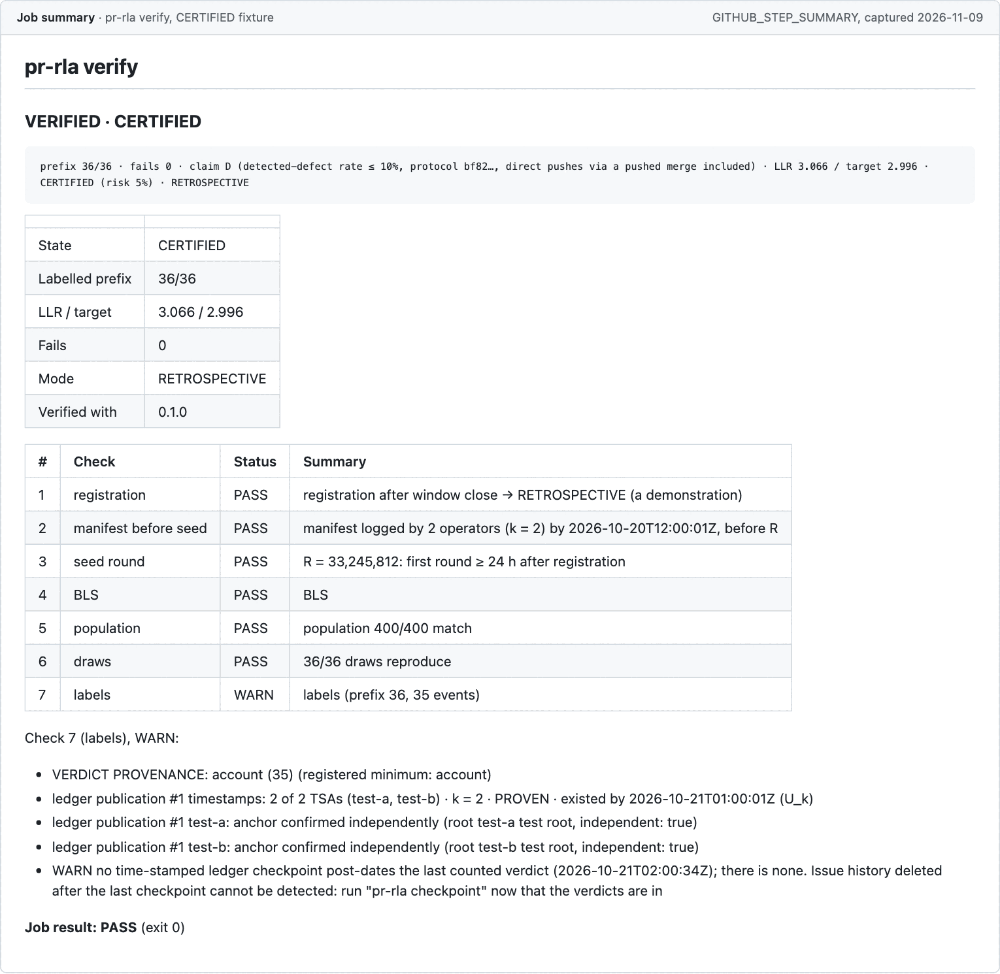
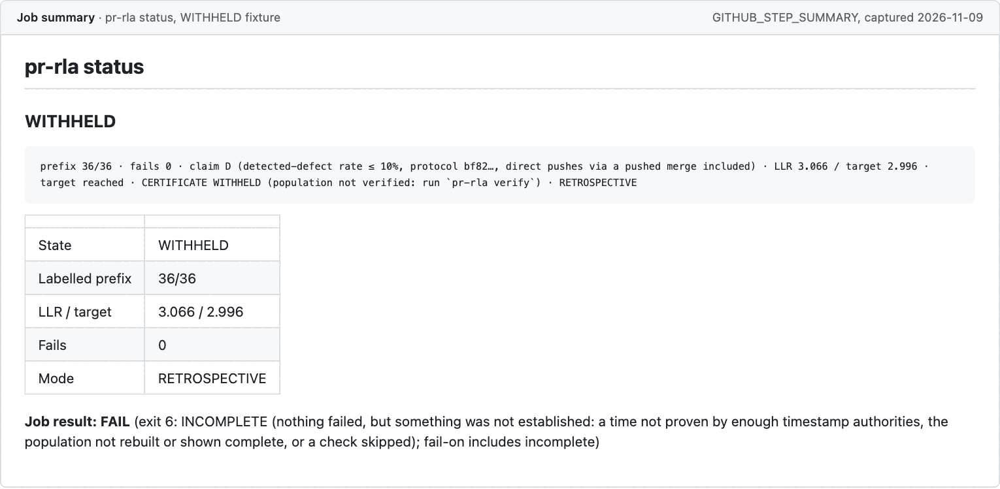
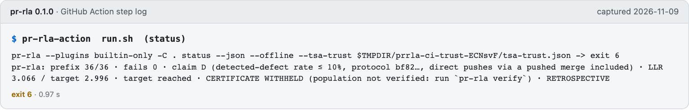

# pr-rla in GitHub Actions

A composite action, `integrations/github-action/`. It installs the pr-rla version pinned by its own `package.json` and `package-lock.json`, runs `status` (or `verify`, or `checkpoint`; only `verify` can report CERTIFIED, see below), writes the job summary, and fails the job by the exit-code table below.

pr-rla is not published, and nothing here publishes it. The action's lockfile pins a tarball of this repository's build; [Re-pinning at release](#re-pinning-at-release) says what a release changes.

The ledger on GitHub is `github-issues`: the reviewer's label on the draw's issue is the verdict. See [the end-to-end matrix](README.md#end-to-end-matrix).

## An example workflow

```yaml
name: pr-rla
on:
  issues: { types: [labeled, unlabeled] }   # github-issues ledger; runs from the default branch's workflow file
  push: { paths: ["audit/**"] }             # git-file ledger
  schedule: [{ cron: "17 * * * *" }]        # notices the window closing and the seed round publishing
  workflow_dispatch:
permissions: { contents: read, issues: write }   # scopes not listed become none
jobs:
  status:
    runs-on: ubuntu-latest
    steps:
      - uses: actions/checkout@3d3c42e5aac5ba805825da76410c181273ba90b1 # v7.0.1
      - uses: <owner>/pr-rla/integrations/github-action@<full commit SHA>
        with:
          command: status
          comment: ${{ github.event_name == 'issues' }}
```

`<owner>/pr-rla` is where this repository ends up; it has no address yet. Pin the action by full commit SHA, like the other two.

## Inputs

| Input | Default | Meaning |
|---|---|---|
| `command` | `status` | `status`, `verify`, `checkpoint` or `sample`. The last two write to the audit repository and need `allow-writes: true` |
| `dir` | `.` | The audit repository directory, relative to the workspace |
| `offline` | `true` | `--offline` for `status` and `verify` |
| `comment` | `false` | Post the status line on the audit issue (needs `issues: write`) |
| `comment-issue` | the event's issue | The issue to comment on |
| `fail-on` | `escalate,refusal,timestamps,incomplete` | Which of exits 2, 3, 5 and 6 fail the job. Exit 1 and exit 4 always fail |
| `plugins` | `builtin-only` | `allow` lets the audit's locked plugins load |
| `approve-origins` | empty | `ENV_VAR=https://host` entries; see Credentials |
| `tsa-trust` | empty | Timestamp-authority anchor files you trust beyond the shipped bundle, relative to the workspace, separated by commas or newlines; passed to `status`, `verify` and `checkpoint` as `--tsa-trust`. Needed only for an authority outside the shipped bundle: without it such an audit's certificate is `WITHHELD` (exit 6; with an issue ledger, exit 1, since check 7 FAILs a draw → issue publication its authorities are not trusted for) |
| `accept-lock-grants` | `false` | Only for an audit repository you control |
| `allow-writes` | `false` | Permit `checkpoint` and `sample` |
| `token` | `github.token` | What pr-rla reads as `GITHUB_TOKEN`, and what the comment is posted with |

There is no `sample` by default: issuing draws and opening issues are writes. `command: sample` runs `pr-rla sample` (never `--submit`) only with `allow-writes: true`, and a human normally runs it.

## Outputs

| Output | Meaning |
|---|---|
| `state` | The certificate's state: `CERTIFIED` (only from `verify`: `status` never certifies), `WITHHELD` (the target is reached, but something withholds the certificate, such as a time not proven by enough timestamp authorities), `NOT_CERTIFIED`, `ESCALATE`, `REFUSED` or `INCOMPLETE` (the verdicts could not be read); empty for `checkpoint` and `sample`, and for an offline `verify` of a tracker ledger (it reads no verdicts). It is pr-rla's `certificate.state`, never the sequential test's raw `sequence.state` |
| `prefix` | The longest fully labelled prefix as `labelled/issued`, for example `24/36` |
| `llr` | The log-likelihood ratio, to three decimals |
| `json` | Path to the command's `--json` output (`status` and `verify`) |
| `exit-code` | pr-rla's exit code |

## The job summary

Every run appends to `$GITHUB_STEP_SUMMARY`: the certificate line, a table of the state, prefix, LLR and mode, for `verify` the verdict and the seven checks (with the details of any check that is not a PASS), anything pr-rla said on standard error, and the job result with the rule that decided it. For exit 4 it also shows the command that finishes the job. Everything from the audit is escaped as data before it goes into markdown, and a line of pr-rla's output that starts with `::` is indented in the log so it cannot be read as a workflow command.

What the summary looks like, rendered from the real `GITHUB_STEP_SUMMARY` of the action's own steps (run on a fixture: the harness of `test/ci-github-action.test.ts`, with a synthetic 400-change population, mock timestamp authorities and a fake tracker on 127.0.0.1):



*`pr-rla verify`, run 2026-11-09 through the action's steps on a CERTIFIED fixture: the summary ends "Job result: PASS" and the job passes.*



*`pr-rla status`, run 2026-11-09 through the action's steps on the same fixture: the target is reached but `status` never certifies, so the state is WITHHELD and the job fails with exit 6.*



*The run step's own log for the WITHHELD fixture, run 2026-11-09: the exact command the action ran, and its exit code.*

## Exit codes

| Code | The job |
|---|---|
| 0 | Passes |
| 1 | Always fails |
| 2 | Fails when `fail-on` includes `escalate` (the default) |
| 3 | Fails when it includes `refusal` (the default) |
| 4 | Always fails, with the re-run command in the summary |
| 5 | Fails when it includes `timestamps` (the default) |
| 6 | Fails when it includes `incomplete` (the default): `verify` could not rebuild the population or show it complete |

Any other code (the binary missing, a signal) fails the job.

## Events caused by `GITHUB_TOKEN`

An event caused by `GITHUB_TOKEN` starts no workflow run, except `workflow_dispatch` and `repository_dispatch`. That is right here: the human's label or push is the trigger, and the action's own comment cannot loop.

## The budget

`GITHUB_TOKEN` gets 1,000 REST requests an hour per repository. Online `verify` of a large population needs far more (the gh-aw audit needs thousands of GraphQL and REST calls). So the example runs `status` and `verify --offline` on events, and an online `verify` weekly with a read-only fine-grained personal access token passed as `token`.

## Checkpoints

`command: checkpoint` runs `pr-rla checkpoint --push`: it hashes the ledger's verdict history, time-stamps it, commits `audit/<window>/ledger-checkpoints.jsonl` and pushes, never forced. It needs `allow-writes: true`, `contents: write`, and a checkout that kept its credentials (the default of `actions/checkout`). The commit is made as `github-actions[bot]` unless the repository sets an identity. It fits the `github-issues` and `gitlab-issues` ledgers; `git-file` has the git history itself as its trail and refuses.

## Credentials

pr-rla reads credentials from the environment and sends each only where a local approval allows. In a workflow, the person who writes the workflow file is the one who approves; the audited repository is never asked.

| You use | Provide | Sent to | Approval |
|---|---|---|---|
| github.com | `token` (default `github.token`) | `https://api.github.com` | Built in |
| GitHub Enterprise Server | a token in `token`, or `GH_ENTERPRISE_TOKEN` in `env:` | your host | `approve-origins: GITHUB_TOKEN=https://ghe.example.com` |
| A different variable name (`token_env` in `.pr-rla.yml`) | that variable in `env:` | wherever you say | `approve-origins: NAME=https://host` |

- Each entry runs `pr-rla plugin approve --env ENV_VAR --origin https://host --yes`, with the approvals file in `$RUNNER_TEMP` (`PR_RLA_APPROVALS_FILE`). The action refuses an approvals file inside the workspace.
- `accept-lock-grants: true` takes the grants and trust in the audit repository's `pr-rla.lock.json` as given. Use it only for an audit repository you control.
- A withheld credential is not an error to pr-rla: the ledger runs anonymously. When a private tracker then refuses every read, the verdicts were not read, so the state is `INCOMPLETE` and pr-rla exits 6, which fails the job by default; the summary carries `is not approved on this machine, so withheld` and the `pr-rla plugin approve` command. If you see it, add the origin to `approve-origins`.

## Pinning

- `actions/setup-node` is pinned by commit SHA `949feb2413d6458794dcd2491c4babbbce0c15c1` (tag v7.1.0, looked up with `gh api` on 2026-11-04) at `node-version: 24`, with its package-manager cache off. Node 24 has been the runner default since 2026-06-16.
- `pr-rla` is a dependency in the action's `package.json` and `package-lock.json`, installed with `npm ci --ignore-scripts`. `npx pkg@version` would not check an integrity hash; a lockfile does.
- No `${{ }}` expression appears inside a `run:` script. Inputs reach the scripts as environment variables, so an input value is data, never shell text.

### Re-pinning at release

Until release, `package.json` has `"pr-rla": "file:vendor/pr-rla-0.1.0.tgz"` and the lockfile records `resolved: file:vendor/pr-rla-0.1.0.tgz` and the sha512 of that tarball. `node scripts/pack-action-tarball.mjs` rebuilds the tarball and rewrites both. The release checklist (U10) re-pins to the published package. Exactly:

1. After the founder publishes `pr-rla@X`, in `integrations/github-action/package.json` set `"pr-rla": "X"` (the exact version, no `^`).
2. Delete `integrations/github-action/package-lock.json`, `node_modules/` and `vendor/`, then run `npm install --package-lock-only --ignore-scripts` there. The lockfile now records `resolved: https://registry.npmjs.org/pr-rla/-/pr-rla-X.tgz` and the registry's `integrity`.
3. Check that entry: `resolved` starts with `https://registry.npmjs.org/`, and its `integrity` equals `npm view pr-rla@X dist.integrity`.
4. Delete `scripts/pack-action-tarball.mjs` and the `!integrations/github-action/vendor/…` exception in `.gitignore`.
5. In `integrations/gitlab/templates/pr-rla.yml`, the `version` default is `X`, and the `integrity` default may be that same `integrity`; in the snippet in `docs/ci/gitlab.md` and the step in `docs/ci/bitbucket.md`, `PRRLA_VERSION` is `X` (and `PRRLA_INTEGRITY` may be set). `test/ci-integrations.test.ts` reads the root `package.json` version, so those tests need no edit.
6. Replace `<owner>/pr-rla` and `<exact ref>` in these pages with the repository's address once it has one.
7. Run `npm --prefix integrations/github-action ci` and `npm test`.

Whether `pr-rla` ships an `npm-shrinkwrap.json`, which would pin the transitive dependencies for the GitLab and Bitbucket installs (they have no lockfile of their own), is the founder's decision, with a recommendation and its reasons: [`../release-checklist.md`](../release-checklist.md), step 4. The re-pinning above is that checklist's step 19.
