# Delivery Plan: pr-rla phases 3–4

**Stage:** Delivery Planning. It turns the topology in `unit-of-work-dependency.md` into the build sequence the founder chose: risk-first, with U8 before U9.

- **Dates.** There are none, by the founder's instruction (feasibility Q2): take the time needed. The day estimates follow the draft's convention (a solo founder with Claude Code) and are for sizing only.
- **Bolts.** Each one is a single unit, so a unit's work is finished and checked before the next starts.

## Sequence

```mermaid
flowchart LR
    B1["1. U1 Trusted time"] --> B2["2. U2a Fetch broker"] --> B3["3. U4 Issue ledgers"] --> B4["4. U2b Plugin host"] --> B5["5. U3 SDK carry-overs"] --> B6["6. U5 Audit API + MCP"] --> B7["7. U7 CI"] --> B8["8. U6 Assistants"] --> B9["9. U8 Org-pooled freeze"] --> B10["10. U9 Presence verdicts"] --> B11["11. U10 Docs + release"]
```



<!-- Text fallback: eleven bolts in order: U1 trusted time, U2a fetch broker, U4 issue ledgers, U2b plugin host, U3 SDK carry-overs, U5 audit API and MCP, U7 CI, U6 assistants, U8 org-pooled freeze, U9 presence verdicts, U10 docs and release. -->

Every bolt starts only when the units it depends on are done (`unit-of-work-dependency.md`). U1 runs before U2a by binding to the broker contract through a minimal adapter (`contracts.md` §2). U1 switches to the real broker in bolt 2.

| # | Bolt | Why here | Settles first | Definition of done | Estimate |
|---|------|----------|---------------|--------------------|----------|
| 1 | U1 Trusted time | The gh-aw timing proof stands on it, and the prospective registration cannot start until it exists | RK-04 (Rekor v2 shapes stay unverified; kept off the critical path); RK-05 (live tokens from all eight authorities) | FR1.1–FR1.11 pass. The library evaluation is recorded (FR1.3). Six tamper fixtures fail as specified. v1 E2E prints 7/7. The gh-aw config and `register` command are prepared, and the founder runs `register` (FR1.9) | 3 days |
| 2 | U2a Fetch broker | Every later unit fetches through it, and it lays the `src/api` foundation | The read-only guard, the per-host budget, and default rate values equal to published limits | FR10.1–FR10.5 and NFR12, NFR14 pass. The phase-2 suite passes unchanged, with built-ins at `maxRetries: 0` behind the broker. U1 is rewired onto the broker. `src/api/context.ts` exists with read-only and read-write modes | 1.5 days |
| 3 | U4 Issue ledgers | Its label-event behaviour is the largest unverified foundation (RK-03), and the default provenance depends on it | RK-03, through read-only recordings of public issue timelines | FR4.1–FR4.8 pass on recorded and synthetic fixtures, each fixture marked. The ledger kit passes on both built-ins and the Jira example. `checkpoint --push` passes the cross-clone test against a local bare repo | 2.5 days |
| 4 | U2b Plugin host | The isolation limits (RK-02) shape the security model, and U8 runs plugins through it | RK-02: the Node 25 IPC test, run or recorded as unverified | FR2.1–FR2.7 pass. The Gitea plugin passes the kit through the host. The hostile-plugin fixture is contained as `functional-design.md` §U2b says | 2 days |
| 5 | U3 SDK carry-overs | U5 and U8 need its fields | RK-09 (pinned head) | FR7.1–FR7.7 pass. Every built-in and the Gitea plugin pass the extended kit | 1.5 days |
| 6 | U5 Audit API + MCP | Metric 3's assistant path | RK-06 (client behaviour), RK-10 (untrusted content) | FR3.1–FR3.6 and FR3.9 pass. Every command runs through `src/api`. `pr-rla/api/read` exists and the import-graph guard passes. `mcp-readonly.test.ts` passes. NFR10 timings pass on fixtures | 3 days |
| 7 | U7 CI | Metric 3's CI path | That CI paths work on mocks without scratch repos (D8) | FR6.1–FR6.7 pass on fixtures and mock servers. Templates pass schema checks | 1.5 days |
| 8 | U6 Assistants | Founder priority (Must) | RK-06: the founder's manual runs in Claude Code, Codex and Cursor | FR3.7 passes. Hook tests pass (10 blocked, 10 allowed). Three dated manual runs are in BUILD-NOTES | 1 day |
| 9 | U8 Org-pooled freeze | Should; built before release | RK-07 (rate budgets at org scale) | FR5.1–FR5.8 pass. Resume is byte-identical on the synthetic 40-repo org. The estimate is within ±20% of requests and ±50% of wall time. The navikt read-only dry run is recorded | 3 days |
| 10 | U9 Presence verdicts | Could; built and tested with software keys | RK-01 and RK-12, stated as limits | FR9.1–FR9.6 pass on software-key fixtures. No doc or certificate claims hardware-verified presence | 1.5 days |
| 11 | U10 Docs + release | Last: it documents finished behaviour | none | FR8.1–FR8.3 pass. The release checklist exists. No publish step ran | 2 days |

**Total:** about 22.5 days, against the draft's 20.5. The extra two days cover the library evaluation (U1), the `src/api` foundation (U2a), the public-timeline recordings (U4), the full command refactor (U5) and the mock-server CI harness (U7).

**The gh-aw registration and the build.**
- The founder can register right after bolt 1. The registration fixes the fields listed in `functional-design.md` §U1, and uses the `git-file` ledger, so its provenance is `self-asserted`.
- `freeze` for gh-aw must run with a build that includes bolt 5 (U3, pinned head).
- Registering after bolt 3 (U4) instead would allow `account` provenance through `github-issues`.

## Verification command

Every bolt is verified from a clean checkout of `pr-rla` with:

```
npm ci && npm run build && npm run typecheck && npm test
npm --prefix packages/pr-rla-mcp ci && npm --prefix packages/pr-rla-mcp test        # from bolt 6
npm --prefix examples/providers/gitea ci && npm --prefix examples/providers/gitea test
npm --prefix examples/ledgers/jira ci && npm --prefix examples/ledgers/jira test     # from bolt 3
npm --prefix integrations/github-action ci                                           # lockfile check, from bolt 7
```

The lines marked "from bolt n" apply once that bolt has created the package. `npm test` makes no network call (NFR11). Live work, all read-only or hash-only, is listed per bolt in `test-design.md` §4 and recorded in BUILD-NOTES with its date.

## Demo per bolt

| Bolt | Demo |
|------|------|
| U1 | `register` on a fixture audit prints `timestamps: 4 of 4 … k = 2 · PROVEN`; a forged token makes `verify` check 1 FAIL |
| U2a | A guarded `POST` throws `ReadOnlyViolation`; two parallel callers share one budget |
| U4 | A recorded public timeline with a remove and re-add shows WARN; a deleted-issue fixture shows FAIL |
| U2b | The hostile plugin reads a placeholder, not the token |
| U3 | `bots: ["gitlab-bot"]` moves exactly 4 MRs on recorded gitlab-org/cli data |
| U5 | `draw_context` on a recorded gh-aw draw in an MCP client; the audit directory hash is unchanged |
| U7 | The Action harness on a fixture ESCALATE fails the job |
| U6 | `review-draw` in Claude Code, ending with the human's own `record` command |
| U8 | A killed and resumed 40-repo freeze gives the same manifest |
| U9 | A software `-sk` fixture with UP set passes at `presence`, and one with UP clear fails |
| U10 | `npm pack --dry-run` lists only `dist/`, README and CHANGELOG |

## Kept, changed and added against the draft's `04`

- **Kept.** The draft's per-unit acceptance, except where listed below, and its estimates as a baseline.
- **Changed.**
  - The order is the founder's risk-first one, not the draft's.
  - U1 no longer includes a Rekor staging entry.
  - U4 and U7 no longer use scratch repos.
  - U9 no longer uses the founder's FIDO key.
  - U8 is built in this round.
  - The estimate bound in U8 is ±20% of requests (the draft's test said ±25%) plus ±50% of wall time.
- **Added.**
  - A definition of done that names the FR IDs and the risks each bolt settles.
  - One verification command for every bolt.
  - A demo per bolt.
