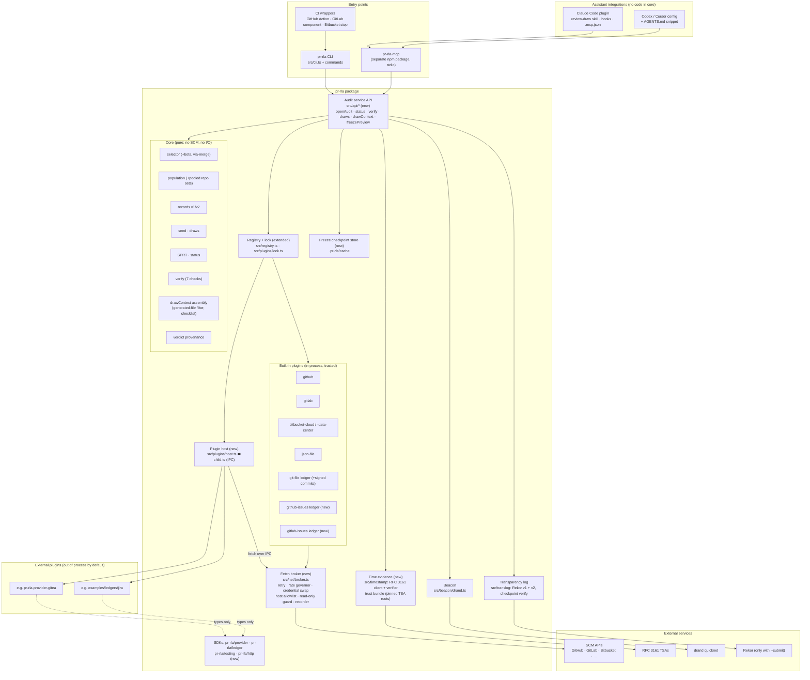
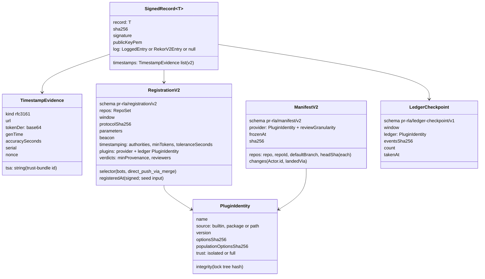
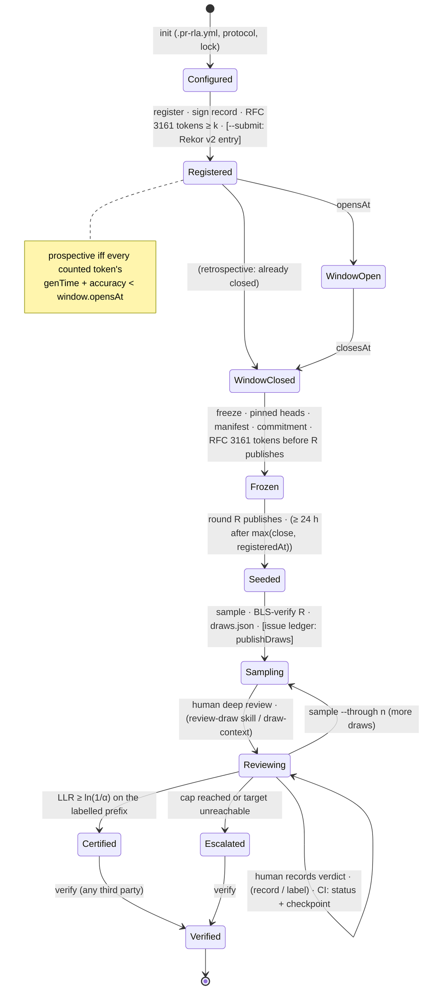
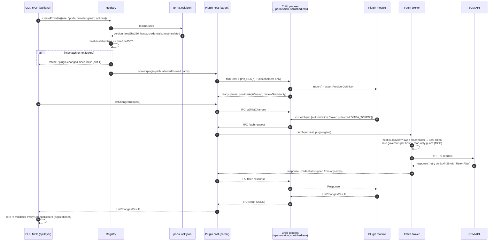
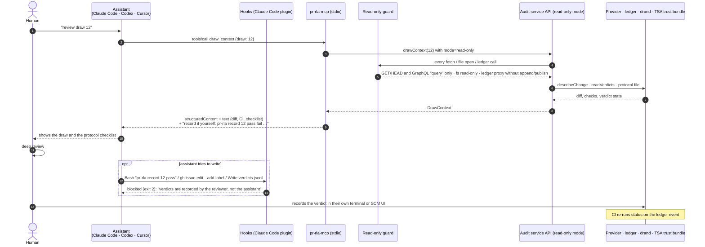

# 03 · Application design

Components, interfaces and data shapes for phases 3–4. Unit-level behaviour is in `05`; this document fixes the boundaries those designs must respect.

## 1. Component view



Boundary rules. The existing `architecture boundaries` test is extended to enforce each one.
1. `src/core/*` imports only `src/sdk/*` and other core modules. It does no I/O; RFC 3161 *parsing* is pure and lives in `src/timestamp/der.ts`, while fetching does not. The core never imports `src/plugins`, `src/net` or `src/api`.
2. `src/api/*` is the only layer that composes I/O: config, files, registry, broker, beacon, TSA, log. CLI commands become thin formatters over it. The MCP package depends on `pr-rla` (`.` export) and on nothing internal.
3. Built-in plugins call `ctx.fetch`, which is the broker. No plugin, built-in or external, constructs its own HTTP client. That is already true; the kit's `transient-faults` check fails a provider that bypasses the harness.
4. External plugins are reached only through the plugin host, unless the lock marks them `trust: full`.

## 2. Component responsibilities (new or changed)

| Component | Responsibility | Unit |
|---|---|---|
| Audit service API (`src/api`) | One function per user-visible operation, returning structured results (the same objects `--json` prints). Takes an `AuditContext` with an injected `mode: "read-write" \| "read-only"`. In read-only mode it never writes files, ledgers or logs. | U5 |
| Time evidence (`src/timestamp`) | Build TimeStampReq (SHA-256 imprint, nonce, certReq), POST to each TSA, parse and verify TimeStampToken offline against the trust bundle, return `TimestampEvidence`. | U1 |
| Transparency log (`src/translog`) | Keep the v1 client. Add the v2 client (`/api/v2/log/entries`), its inclusion proof and signed-checkpoint verification. Submit only on `--submit`. | U1 |
| Registry + lock | Resolve `use`, compute plugin identity, check `pr-rla.lock.json`, choose in-process vs host. | U2 |
| Plugin host | Spawn a child Node process with a scrubbed env and the permission model, import the plugin there, proxy `create` / `listChanges` / ledger calls over IPC, and enforce timeouts and cancellation. | U2 |
| Fetch broker | The only network path for plugins. Per-host token bucket shared across repos (org pooling), retry and `Retry-After` / `RateLimit-*` (moved from `src/providers/http.ts`), placeholder → credential swap on allowlisted hosts, read-only guard (MCP), recording (fixtures). | U2, U5, U8 |
| Issue ledgers | `publishDraws` (one issue per draw), `readVerdicts` from label-event history, `verifyIntegrity`, `readHistory` for checkpoints. | U4 |
| Freeze checkpoint store | Per-run, content-addressed response cache and per-repo completion markers. Freeze resumes; verify never reads it. | U8 (Q7) |
| `pr-rla-mcp` | stdio MCP server, read-only tools over the audit service API. | U5 |
| Claude Code plugin | `review-draw` skill, `.mcp.json`, PreToolUse hooks. | U6 |
| CI wrappers | Thin, version-pinned invocations of the CLI. | U7 |

## 3. SDK deltas (all additive within API version 1)

The rule set by `ProviderContext.sleep`, which was added under the same API version: an **optional** field or method that old plugins can ignore is additive. Anything a plugin *must* now do, or a changed meaning, bumps the version.

### `pr-rla/provider`
```ts
interface Actor { login: string; kind: ActorKind; id?: string }            // Q6
interface ChangeRecord { /* … */ landedVia?: string }                       // Q4: merge sha that brought it in
interface ListChangesRequest { /* … */ head?: string }                      // Q2: walk history from this sha
interface ListChangesResult { /* … */ headSha?: string }                    // Q2
interface ProviderDefinition {
  /* … */
  reviewGranularity?: "submission" | "first-comment-per-user";            // Q5
  hosts?: (options) => string[];                                            // U2: hosts the broker allows
  credentials?: { env: string; hosts: string[] }[];                         // U2: env vars it may read
}
interface ScmProvider {
  /* … */
  listRepos?(set: RepoSetRule): Promise<RepoRef[]>;                         // U8: org/group/workspace listing
  describeChange?(change: ChangeRecord): Promise<ChangeDescription>;        // U5: for draw_context
}
interface RepoRef { repo: string; id: string; defaultBranch: string; archived: boolean; fork: boolean; visibility: "public" | "private" | "internal" }
interface ChangeDescription {
  title: string; body: string;
  files: { path: string; status: "added" | "modified" | "removed" | "renamed"; additions: number; deletions: number; patch: string | null }[];
  gitattributes: string | null;                                             // .gitattributes at mergeSha, for linguist-generated
  checks: { name: string; state: "success" | "failure" | "neutral" | "pending" | "skipped" | "unknown"; url: string | null }[];
  truncated: boolean;
}
```

### `pr-rla/ledger`
```ts
type ProvenanceLevel = "self-asserted" | "account" | "presence";            // FR-M8
interface VerdictEvent { /* … */ provenance?: { level: ProvenanceLevel; source: string; actorId?: string; viaApp?: string | null; eventId?: string } }
interface LedgerHistoryEvent { id: string; at: string; actor: Actor; action: "add" | "remove" | "edit" | "delete-issue" | "transfer"; label: string | null; draw: number | null; raw?: unknown }
interface Ledger {
  /* … */
  readHistory?(): Promise<LedgerHistoryEvent[]>;                            // FR-L4 checkpoints
}
interface LedgerDefinition { /* … */ hosts?: (options) => string[]; credentials?: { env: string; hosts: string[] }[] }
```

### `pr-rla/http` (new subpath, own semver: Q8)
`createJsonClient({ base, headers, fetch, sleep, log, maxRetries })`, the phase-2 client from `src/providers/http.ts`, unchanged.

## 4. Data model: record schemas v2

v1 files keep verifying (NFR-C1). Writers emit v2 from phase 3 on. A v2 record differs from v1 only where listed.



- **`RepoSet`.** Either `{ kind: "repo", repo }`, which is v1-equivalent, or `{ kind: "list", repos: string[] }`, or `{ kind: "rule", owner, include: glob[], exclude: glob[], archived: false, forks: false, visibility: [...] }` (U8).
- **`populationOptionsSha256`.** A hash over only the options a provider declares as stratum-relevant (`base_url`, `bots`, `default_branch`). These FAIL check 5 on mismatch; other options WARN (Q3).
- **`pr-rla.lock.json`.** Committed in the audit repo; not a signed record. `{ schema: "pr-rla/lock/v1", plugins: { "<use>": { source, name, version, resolved, npmIntegrity, treeSha256, trust, hosts, credentials } } }`.

## 5. Audit lifecycle (with phase-3 evidence)



## 6. Plugin call sequence (external provider, isolated)



## 7. MCP request flow


