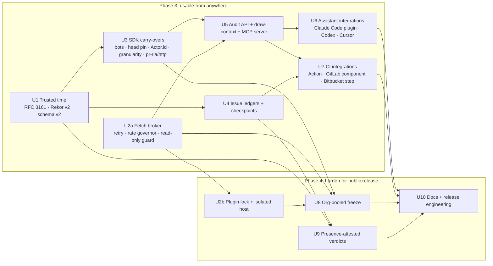

# 04 · Units of work

Eleven units. **Stage-major**: `05` (functional design) and `06` (NFR design) cover every unit before any code is written. The order below is the build order, which starts after this design is approved.

## Dependency graph and order

Build order: **U1 → U3 → U2a → U5 → U4 → U6 → U7**, then **U2b → U8 → U9 → U10**.

**U1 is on the business critical path.** The validation gate needs a *prospective* gh-aw registration, which needs tamper-evident time. Until U1 ships, every registration says `TIMESTAMP NOT TAMPER-PROOF`. Seven weeks of window cannot be added back later, so the gate slips one day for every day U1 slips.

## Units

Estimates assume a solo founder with Claude Code, in the same terms as the spec's day estimates. "Verified" means a command was run and its output recorded in BUILD-NOTES.

### U1 · Trusted time (FR-T1–T6, P1-a)
- **Scope.**
  - `src/timestamp/` holds the RFC 3161 request, a pure DER/CMS verifier and the trust bundle.
  - Record schema v2 is defined *in full* (every v2 field from `03` §4, including fields later units fill), so the schema changes once.
  - Rekor v2 client plus checkpoint verification.
  - `register`/`freeze` request tokens; `verify` checks 1–3 read them.
- **Acceptance.**
  - Recorded tokens from every bundled TSA verify offline.
  - Six tamper fixtures fail: edited genTime, wrong imprint, foreign root, expired signer, token outside tolerance, and too few tokens for k.
  - The existing v1 E2E still prints 7/7.
  - One real token per bundled TSA is fetched live. Only a hash is sent and nothing is permanent; this is founder decision D2 in the README.
- **Estimate.** 2.5 days.

### U3 · SDK carry-overs (FR-X1–X5)
- **Scope.** `selector.bots`, `selector.direct_push_via_merge`, `ListChangesRequest.head` / `ListChangesResult.headSha`, `Actor.id`, `ChangeRecord.landedVia`, `reviewGranularity`, the `pr-rla/http` export, and kit checks `pinned-head`, `actor-ids` and `review-granularity`. Built-in providers implement `head` and `Actor.id`.
- **Acceptance.**
  - All built-in providers and the Gitea plugin pass the extended kit.
  - On recorded gitlab-org/cli data, `bots: ["gitlab-bot"]` moves exactly 4 MRs into the stratum.
  - A synthetic late-pushed commit no longer fails check 5.
- **Estimate.** 1.5 days.

### U2a · Fetch broker (FR-P3 partial, FR-M2, FR-O5)
- **Scope.**
  - `src/net/broker.ts` takes over retry and rate-limit handling from `src/providers/http.ts`.
  - It adds per-host token buckets, the read-only guard, the recorder hook, and credential placeholders (inert until U2b).
  - Built-ins get `ctx.fetch = broker`.
- **Acceptance.**
  - The phase-2 suite passes unchanged.
  - Under the guard, a POST that is not a GraphQL query throws `ReadOnlyViolation`.
  - Two parallel callers on one host share one budget (test with a fake clock).
- **Estimate.** 1 day.

### U5 · Audit service API + draw-context + MCP server (FR-M1–M6)
- **Scope.**
  - `src/api/` provides `openAudit`, `status`, `verify`, `draws`, `drawContext`, `freezePreview` and `auditList`. CLI commands are refactored to format these results.
  - `describeChange` on the built-in providers.
  - `pr-rla draw-context <n>`.
  - The `pr-rla-mcp` package: stdio, seven tools, progress, a job handle for `freeze_preview`.
- **Acceptance.**
  - The MCP conformance test drives every tool through the SDK client over stdio against a fixture audit directory. It asserts the directory is byte-identical before and after, and that the broker saw zero non-read requests.
  - `draw_context` on a recorded gh-aw draw drops `linguist-generated` files.
  - It is checked manually in Claude Code, Codex and Cursor.
- **Estimate.** 2.5 days.

### U4 · Issue ledgers + checkpoints (FR-L1–L5)
- **Scope.**
  - Built-in `github-issues` and `gitlab-issues` (publishDraws, label-event history, integrity).
  - `readHistory`.
  - `status --checkpoint` writes `ledger-checkpoints.jsonl` (+ TSA).
  - `examples/ledgers/jira` (external).
  - A ledger conformance kit: `runLedgerConformance` in `pr-rla/testing`.
- **Acceptance.**
  - Recorded timelines cover: a clean first label; remove + re-add before any other event (WARN); remove after counting (FAIL); a scoped-label swap on GitLab; a label renamed in the repo; a deleted issue (FAIL); and an app-applied label (provenance `account` with `viaApp`, flagged).
  - A deleted event shows as a checkpoint mismatch.
- **Estimate.** 2 days.

### U6 · Assistant integrations (FR-M7)
- **Scope.** `integrations/claude-code/` holds `.claude-plugin/plugin.json`, the `skills/review-draw/SKILL.md`, `.mcp.json` and a `hooks/` guard. A `marketplace.json` sits at the repo root. Codex and Cursor get config snippets and an AGENTS.md block.
- **Acceptance.**
  - Hook unit tests (stdin JSON → exit code) cover ten blocked and ten allowed commands.
  - A manual run in each client is recorded in BUILD-NOTES.
- **Estimate.** 1 day.

### U7 · CI integrations (FR-C1–C4)
- **Scope.** `integrations/github-action/action.yml` (composite), `integrations/gitlab/templates/pr-rla.yml` (CI/CD component) and `docs/ci/bitbucket.md` (step snippet).
- **Acceptance.**
  - The action runs under `act` or in a scratch private repo the founder owns. That is a real write to the founder's own repo, which needs their go-ahead.
  - The GitLab component passes `gitlab-ci-lint` (API, read-only) on a scratch project.
  - YAML schema checks run in vitest.
- **Estimate.** 1.5 days.

### U2b · Plugin lock + isolated host (FR-P1–P6)
- **Scope.** `pr-rla.lock.json`, `pr-rla plugin add|check|lock`, tree hashing, the plugin host (child process, scrubbed env, permission model, IPC), the `trust: full` opt-in, and `--plugins builtin-only`.
- **Acceptance.**
  - The Gitea plugin passes the kit *through the host*.
  - A hostile fixture plugin cannot read `GITHUB_TOKEN` from `process.env` and cannot write outside its allowed paths.
  - Its exfiltration attempt is reported as a known limit (`06` §2) and asserted where it can be.
- **Estimate.** 2 days.

### U8 · Org-pooled freeze (FR-O1–O5)
- **Scope.** `RepoSet` rules, `listRepos` (GitHub org, GitLab group with subgroups, Bitbucket workspace), pooled population, the checkpoint store and resume, and `--estimate`.
- **Acceptance.**
  - On a synthetic 40-repo org with injected 429s and one killed run, the resumed freeze gives a manifest byte-identical to an uninterrupted run.
  - Live read-only dry run on navikt (163 Copilot PRs over 41 repos per the spec), recorded.
- **Estimate.** 3 days.

### U9 · Presence-attested verdicts (FR-M8 level `presence`)
- **Scope.**
  - git-file ledger option `require_signed`.
  - SSHSIG verification of commit signatures in pure TypeScript (ed25519, ed25519-sk, ecdsa-sk) over node:crypto, checking the FIDO user-presence flag.
  - Registered `reviewers` allowed-signers.
  - `minProvenance` enforcement in check 7.
- **Acceptance.**
  - Fixtures cover: an sk signature with UP set, which passes; UP clear (made with `no-touch-required`), which fails at `presence`; a software ed25519 key, which is level `account`; and an unlisted signer, which fails.
  - Cross-checked against `ssh-keygen -Y verify` output.
- **Estimate.** 1.5 days.

### U10 · Docs + release engineering (FR-D1–D2, NFR-C2)
- **Scope.**
  - The doc set from FR-D1, written alongside each unit, with a final pass here.
  - A compatibility table, CHANGELOG and SECURITY.md.
  - `npm pack` dry-run checks (files, exports, no fixtures with secrets).
  - A release checklist.
  - No publish (C-5).
- **Acceptance.**
  - Every doc command is re-run and its output dated.
  - `npm pack --dry-run` lists only `dist/`, README and CHANGELOG.
  - The secret grep over the tarball is clean.
- **Estimate.** 2 days.

**Total.** About 20.5 days: phase 3 is about 12, phase 4 about 8.5.
