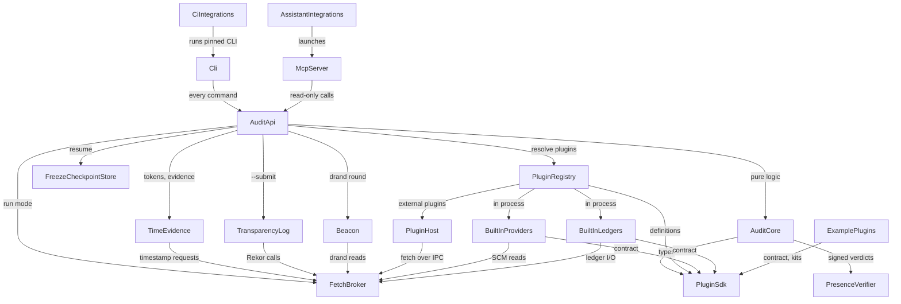

# Components: pr-rla phases 3–4

The logical building blocks of pr-rla after phases 3–4: code that gets written, not infrastructure. They realize the approved `inception/requirements-analysis/requirements.md` (FR1–FR10, NFR1–NFR19) and refine the draft's `pr-rla/docs/design/phase-3-4/03-application-design.md`. The decisions behind the boundaries are in `decisions.md`, and the founder's answers this stage relies on are in `domain-design-questions.md`.

Entities are given at the ownership-and-shape level only; types, constraints and cardinality belong to Functional Design.

```yaml
components:
  - name: Cli
    summary: The pr-rla command line; thin formatters over the audit API
    behaviour: >
      Parses commands and flags with commander, calls one AuditApi function per command in
      read-write mode, and prints its structured result as text or --json. Owns the exit-code
      contract (0, 1, 2, 3, 4, 5; NFR16). Holds no audit logic of its own.
    responsibilities:
      - Command parsing and output formatting
      - Exit codes
      - The explicit plugin add, check and lock commands
    depends_on:
      - component: AuditApi
        interaction: Every command calls one audit API function
        style: sync
    dependents:
      - component: CiIntegrations
        interaction: CI wrappers invoke the pinned CLI
    external_dependencies:
      - name: commander
        kind: other
        purpose: Command-line parsing
    entities: []

  - name: McpServer
    summary: The separate pr-rla-mcp package; a stdio MCP server with eight read-only tools
    behaviour: >
      Exposes audit_list, status, draws, draw_context, verify, simulate, freeze_preview and
      job_status. Calls AuditApi in read-only mode only and never passes --checkpoint. Writes
      nothing anywhere on disk. Long calls (freeze_preview, online verify) return within 30 s
      or hand back a job handle; job state lives in memory only, is unknown after a restart,
      and a finished freeze_preview is cached in memory for 10 minutes.
    responsibilities:
      - MCP tool surface and output schemas
      - In-memory job registry and preview cache
      - Marking SCM-sourced text as untrusted in tool results
    depends_on:
      - component: AuditApi
        interaction: Every tool calls one audit API function in read-only mode
        style: sync
    dependents:
      - component: AssistantIntegrations
        interaction: Assistant configurations launch the server
    external_dependencies:
      - name: "@modelcontextprotocol/server"
        kind: other
        purpose: MCP protocol over stdio
      - name: zod
        kind: other
        purpose: Tool input and output schemas
    entities:
      - name: Job
        identifier: jobHandle
        attributes: [tool, arguments, state, progress, result, startedAt]
      - name: PreviewCacheEntry
        identifier: requestDigest
        attributes: [result, cachedAt]

  - name: AssistantIntegrations
    summary: The Claude Code plugin and the Codex and Cursor setup
    behaviour: >
      The Claude Code plugin carries the review-draw skill, the MCP server configuration and
      PreToolUse hooks that block verdict writes and --submit from the assistant. Codex and
      Cursor get configuration snippets and an AGENTS.md block. The skill never states or
      records a verdict.
    responsibilities:
      - review-draw skill
      - Assistant guard hooks
      - Client configuration for Claude Code, Codex and Cursor
    depends_on:
      - component: McpServer
        interaction: Configures and launches the MCP server in each client
        style: sync
    dependents: []
    entities: []

  - name: CiIntegrations
    summary: The GitHub Action, GitLab CI/CD component and Bitbucket Pipelines step
    behaviour: >
      Thin, version-pinned invocations of the CLI with --plugins builtin-only by default.
      Run status (and verify --offline) on verdict events and schedules, write a job summary,
      and fail on ESCALATE.
    responsibilities:
      - CI templates for three SCMs
      - Mapping exit codes to job outcomes
    depends_on:
      - component: Cli
        interaction: Runs the pinned CLI
        style: sync
    dependents: []
    entities: []

  - name: AuditApi
    summary: The single layer that composes I/O; one function per user-visible operation
    behaviour: >
      Takes an AuditContext with mode read-write or read-only. In read-only mode it writes no
      files, ledger events or logs and puts the fetch broker under its read-only guard. Reads
      configuration and audit files, resolves plugins through the registry, asks TimeEvidence
      for tokens and verified evidence, and passes verified results into the pure core.
      Writes every audit file atomically (temporary file, then rename). Appends ledger
      checkpoints only on status --checkpoint, resolving cross-clone races through git
      (fetch, rebase, re-append, at most 3 retries, never force-push). Refuses a mixed-provider
      pooled registration.
    responsibilities:
      - Composition of config, files, registry, broker, beacon, time evidence and log
      - Read-only and read-write modes
      - Atomic file writes and ledger checkpoint appends
    depends_on:
      - component: AuditCore
        interaction: Pure audit logic (population, seed, draws, status, verify)
        style: sync
      - component: TimeEvidence
        interaction: Obtain and verify RFC 3161 tokens
        style: sync
      - component: TransparencyLog
        interaction: Optional Rekor submission and verification
        style: sync
      - component: Beacon
        interaction: Fetch and verify the drand round
        style: sync
      - component: PluginRegistry
        interaction: Resolve the configured provider and ledger
        style: sync
      - component: FreezeCheckpointStore
        interaction: Resume and checkpoint long freezes
        style: sync
      - component: FetchBroker
        interaction: Set read-only mode and the recorder for the run
        style: sync
    dependents:
      - component: Cli
        interaction: Every command
      - component: McpServer
        interaction: Every tool, in read-only mode
    external_dependencies:
      - name: yaml
        kind: other
        purpose: Reading .pr-rla.yml
      - name: Local file system and git
        kind: other
        purpose: Audit directory, ledger checkpoints, atomic writes
    entities:
      - name: AuditContext
        identifier: auditDir
        attributes: [mode, config, window]

  - name: AuditCore
    summary: Pure audit logic with no I/O; the statistics and verify checks it already holds stay fixed
    behaviour: >
      Selector (registered bots, direct_push_via_merge), population (single repo and pooled
      repo sets), record schemas v1 and v2, seed and draws, SPRT status, the seven verify
      checks, draw-context assembly (generated-file filter, protocol checklist, untrusted
      fences) and verdict provenance with minProvenance enforcement in check 7. The statistics,
      seed derivation and meaning of the seven checks do not change. Imports only the SDK
      and other core modules.
    responsibilities:
      - Record schemas and their validation
      - Population, selector and draws
      - Status, certificate and the seven verify checks
      - Verdict provenance levels
    depends_on:
      - component: PluginSdk
        interaction: ChangeRecord and VerdictEvent types and validators
        style: sync
      - component: PresenceVerifier
        interaction: Verify signed verdicts for the presence level
        style: sync
    dependents:
      - component: AuditApi
        interaction: All audit logic
    entities:
      - name: Registration
        identifier: sha256
        attributes: [repos, window, selector, protocolSha256, parameters, beacon, registeredAt, timestamping, plugins, verdicts]
        references:
          - entity: PluginIdentity
            owned_by: PluginRegistry
            relationship: each registration records the identity of its provider and ledger
          - entity: TimestampEvidence
            owned_by: TimeEvidence
            relationship: each signed registration carries up to n timestamp tokens
          - entity: LogEntry
            owned_by: TransparencyLog
            relationship: a registration may carry one optional Rekor entry
      - name: Manifest
        identifier: sha256
        attributes: [repos, provider, frozenAt, changes]
        references:
          - entity: ChangeRecord
            owned_by: PluginSdk
            relationship: a manifest lists every change in the frozen population
          - entity: PluginIdentity
            owned_by: PluginRegistry
            relationship: each manifest records the provider identity that built it
          - entity: Registration
            owned_by: AuditCore
            relationship: each manifest belongs to one registration
      - name: Draw
        identifier: index
        attributes: [changeId, position]
        references:
          - entity: ChangeRecord
            owned_by: PluginSdk
            relationship: each draw selects one change
          - entity: BeaconRound
            owned_by: Beacon
            relationship: all draws derive from one drand round
      - name: LedgerCheckpoint
        identifier: eventsSha256
        attributes: [window, ledger, count, takenAt]
        references:
          - entity: LedgerHistoryEvent
            owned_by: PluginSdk
            relationship: a checkpoint hashes the full verdict-event list
          - entity: TimestampEvidence
            owned_by: TimeEvidence
            relationship: a checkpoint may carry timestamp tokens
      - name: Certificate
        identifier: registrationSha256
        attributes: [outcome, draws, provenanceLevel, timestampStatus, pluginTrust]
        references:
          - entity: Registration
            owned_by: AuditCore
            relationship: each certificate certifies one registration

  - name: PresenceVerifier
    summary: Pure SSHSIG verification of signed verdict commits, including the FIDO presence flag
    behaviour: >
      Verifies SSHSIG signatures for ed25519, ed25519-sk and ecdsa-sk over node:crypto, checks
      the user-presence flag on -sk signatures, and matches signers against the registered
      allowed-signers list. Reports what it proved: verifier logic only; it never claims
      hardware-verified presence while only software keys have been used.
    responsibilities:
      - SSHSIG parsing and verification
      - User-presence flag check
      - Allowed-signer matching
    depends_on: []
    dependents:
      - component: AuditCore
        interaction: Check 7 presence level
    external_dependencies:
      - name: node:crypto
        kind: other
        purpose: Signature primitives
    entities: []

  - name: TimeEvidence
    summary: RFC 3161 client, token verifier and the pinned trust bundle
    behaviour: >
      Builds a TimeStampReq (SHA-256 imprint, nonce, certReq) for each configured authority and
      sends only that. Retries an authority for at most 5 minutes, then stops; never adds tokens
      to a written record. Verifies tokens offline with a maintained ASN.1/CMS library (chosen by
      evaluation; hand-written only if none qualifies): CMS signature, imprint, timeStamping EKU,
      chain to a pinned root, and genTime within 10 minutes plus accuracy (60 s when unstated).
      Counts operators k-of-n, same-operator tokens once. Refuses when the local clock is more
      than 10 minutes off.
    responsibilities:
      - Token requests and offline verification
      - k-of-n counting and the trust bundle
      - Clock-skew refusal
    depends_on:
      - component: FetchBroker
        interaction: Send TimeStampReq to each authority with a 15 s timeout
        style: sync
    dependents:
      - component: AuditApi
        interaction: Tokens for register, freeze and checkpoints; verified evidence for verify
    external_dependencies:
      - name: RFC 3161 timestamp authorities
        kind: third-party-api
        purpose: Signed time over a hash
      - name: ASN.1/CMS library (pkijs + asn1js, subject to evaluation)
        kind: other
        purpose: Parse TimeStampResp and verify CMS SignedData
    entities:
      - name: TimestampEvidence
        identifier: tsaSerial
        attributes: [tsa, url, tokenDer, genTime, accuracySeconds, serial, nonce]
      - name: TrustBundle
        identifier: bundleDate
        attributes: [authorities, roots, operators]

  - name: TransparencyLog
    summary: Rekor v1 and v2 clients and checkpoint verification
    behaviour: >
      Keeps the v1 client. Adds the v2 client with inclusion-proof and signed-checkpoint
      verification, tested against the published API and mock servers only. Submits only on
      the user's --submit, after saying the v2 client is unverified against the production log.
      Time evidence never depends on it.
    responsibilities:
      - Rekor entry building, submission and verification
    depends_on:
      - component: FetchBroker
        interaction: Rekor HTTP calls
        style: sync
    dependents:
      - component: AuditApi
        interaction: --submit and log verification
    external_dependencies:
      - name: Sigstore Rekor
        kind: third-party-api
        purpose: Optional public discoverability
    entities:
      - name: LogEntry
        identifier: logIndex
        attributes: [version, uuid, body, inclusionProof, checkpoint]

  - name: Beacon
    summary: drand quicknet round fetch and BLS verification
    behaviour: >
      Fetches one round per command and verifies it with drand-client. Offline use through
      --beacon-file.
    responsibilities:
      - Round derivation inputs and BLS verification
    depends_on:
      - component: FetchBroker
        interaction: Read one round from a public relay
        style: sync
    dependents:
      - component: AuditApi
        interaction: sample and verify
    external_dependencies:
      - name: drand quicknet relays
        kind: third-party-api
        purpose: Public randomness
      - name: drand-client
        kind: other
        purpose: BLS verification
    entities:
      - name: BeaconRound
        identifier: round
        attributes: [randomness, signature, publishedAt]

  - name: PluginRegistry
    summary: Resolves providers and ledgers, computes plugin identity, and checks the lock
    behaviour: >
      Resolves `use` to a built-in or an external module, computes its identity, and checks
      pr-rla.lock.json at every load: a tree-hash mismatch refuses to run. A plugin enters the
      lock only through an explicit plugin add, which prints what it trusts; register never
      creates or extends the lock. Chooses in-process (built-ins, trust full) or the plugin host
      (external, the default). Honours --plugins builtin-only.
    responsibilities:
      - Plugin resolution and identity
      - The lock file
      - Trust mode selection
    depends_on:
      - component: PluginHost
        interaction: Run external plugins out of process
        style: sync
      - component: BuiltInProviders
        interaction: Load built-in providers in process
        style: sync
      - component: BuiltInLedgers
        interaction: Load built-in ledgers in process
        style: sync
      - component: PluginSdk
        interaction: Validate plugin definitions and API versions
        style: sync
    dependents:
      - component: AuditApi
        interaction: Resolve the configured provider and ledger
    entities:
      - name: PluginLock
        identifier: use
        attributes: [source, name, version, resolved, npmIntegrity, treeSha256, trust, hosts, credentials]
      - name: PluginIdentity
        identifier: integrity
        attributes: [name, source, version, optionsSha256, populationOptionsSha256, trust]
        references:
          - entity: PluginLock
            owned_by: PluginRegistry
            relationship: an external plugin's identity comes from its lock entry

  - name: PluginHost
    summary: Runs external plugins in a child process with a scrubbed environment
    behaviour: >
      Spawns a child Node process with the permission model and only placeholder credentials,
      imports the plugin there, proxies provider and ledger calls over IPC, and enforces
      timeouts and cancellation. Plugin fetches travel over IPC to the broker. On Node 22 and 24
      it cannot block network; on Node 25 or later the child gets none.
    responsibilities:
      - Process isolation and IPC
      - Placeholder credentials
    depends_on:
      - component: FetchBroker
        interaction: Plugin fetches over IPC
        style: sync
    dependents:
      - component: PluginRegistry
        interaction: Hosts external plugins
    entities: []

  - name: FetchBroker
    summary: The one network path; retries, rate governance, credential swap, read-only guard, recorder
    behaviour: >
      Every outbound HTTP call goes through it, including timestamp authorities, drand and
      Rekor. Retries with exponential backoff and jitter on 429, 5xx, timeouts and truncated
      bodies. Keeps one rate budget per host shared by every caller; defaults are the smallest
      published limits and server-reported headers win. Times out SCM requests at 30 s and
      timestamp requests at 15 s. Swaps placeholder credentials only on declared hosts. Under the
      read-only guard, anything other than GET, HEAD or a GraphQL query throws ReadOnlyViolation.
      Records exchanges for fixtures with credentials and e-mail addresses scrubbed.
    responsibilities:
      - Retry and timeouts
      - Per-host rate governance
      - Credential swap and the read-only guard
      - Fixture recording
    depends_on: []
    dependents:
      - component: AuditApi
        interaction: Run mode and recorder
      - component: TimeEvidence
        interaction: Timestamp requests
      - component: TransparencyLog
        interaction: Rekor calls
      - component: Beacon
        interaction: drand reads
      - component: PluginHost
        interaction: Plugin fetches over IPC
      - component: BuiltInProviders
        interaction: SCM reads
      - component: BuiltInLedgers
        interaction: Ledger reads and writes
    external_dependencies:
      - name: SCM APIs (GitHub, GitLab, Bitbucket, Gitea)
        kind: third-party-api
        purpose: Change history, reviews, issues and labels
    entities:
      - name: HostBudget
        identifier: host
        attributes: [limit, window, remaining, resetAt, source]

  - name: FreezeCheckpointStore
    summary: Per-run response cache and completion markers so long freezes resume
    behaviour: >
      Stores responses keyed by request digest and per-repo completion markers under
      .pr-rla/cache/<window>/<run>/. Freeze resumes from it; verify never reads it.
    responsibilities:
      - Resume and estimate inputs for long and pooled freezes
    depends_on: []
    dependents:
      - component: AuditApi
        interaction: Freeze resume
    external_dependencies:
      - name: Local file system
        kind: other
        purpose: Cache directory
    entities:
      - name: FreezeRun
        identifier: runId
        attributes: [window, repos, completedRepos, startedAt]
        references:
          - entity: Registration
            owned_by: AuditCore
            relationship: each freeze run belongs to one registration

  - name: BuiltInProviders
    summary: GitHub (and Enterprise Server), GitLab, Bitbucket Cloud and Data Center, and the JSON-file provider
    behaviour: >
      The phase-2 providers, reviewed and not redesigned, extended additively: honour the pinned
      head, set Actor.id, declare reviewGranularity, set landedVia, and add describeChange and
      listRepos. All HTTP through ctx.fetch.
    responsibilities:
      - Normalizing each SCM into ChangeRecords
      - Repo listing for pooled freezes
    depends_on:
      - component: FetchBroker
        interaction: SCM reads
        style: sync
      - component: PluginSdk
        interaction: Implement the provider contract
        style: sync
    dependents:
      - component: PluginRegistry
        interaction: Loaded in process
    entities: []

  - name: BuiltInLedgers
    summary: The git-file ledger and the GitHub and GitLab issue ledgers
    behaviour: >
      git-file keeps its append-only history check and adds require_signed. github-issues and
      gitlab-issues open one issue per draw, read verdicts from label event history (first
      verdict event counts), report every removal, re-add, swap, edit, deletion or transfer, and
      honour self-hosted base URLs. All HTTP through ctx.fetch.
    responsibilities:
      - Publishing draws and reading verdicts
      - Integrity and history reads for checkpoints
    depends_on:
      - component: FetchBroker
        interaction: Ledger reads and writes
        style: sync
      - component: PluginSdk
        interaction: Implement the ledger contract
        style: sync
    dependents:
      - component: PluginRegistry
        interaction: Loaded in process
    entities:
      - name: DrawIssue
        identifier: issueNumber
        attributes: [repo, labels, state]
        references:
          - entity: Draw
            owned_by: AuditCore
            relationship: each issue holds one draw; the draw-to-issue index is committed in git

  - name: PluginSdk
    summary: The public contracts pr-rla/provider, pr-rla/ledger, pr-rla/testing and pr-rla/http
    behaviour: >
      Versioned types, defineProvider and defineLedger, validators, the provider and ledger
      conformance kits, and the retrying JSON client under its own version. All new fields are
      optional within provider and ledger API version 1.
    responsibilities:
      - Published plugin contracts and validators
      - Provider and ledger conformance kits
      - The exported HTTP helper
    depends_on: []
    dependents:
      - component: AuditCore
        interaction: Types and validators
      - component: PluginRegistry
        interaction: Definition and version checks
      - component: BuiltInProviders
        interaction: Provider contract
      - component: BuiltInLedgers
        interaction: Ledger contract
      - component: ExamplePlugins
        interaction: Contracts and the kits
    entities:
      - name: ChangeRecord
        identifier: id
        attributes: [kind, mergeSha, commits, author, mergedBy, reviews, mergedAt, landedVia]
        references:
          - entity: Actor
            owned_by: PluginSdk
            relationship: each change has an author, a merger and reviewers
      - name: Actor
        identifier: id
        attributes: [login, kind, id]
      - name: ChangeDescription
        identifier: changeId
        attributes: [title, body, files, gitattributes, checks, truncated]
      - name: RepoRef
        identifier: id
        attributes: [repo, defaultBranch, archived, fork, visibility]
      - name: VerdictEvent
        identifier: eventId
        attributes: [draw, verdict, reviewer, recordedAt, provenance]
      - name: LedgerHistoryEvent
        identifier: id
        attributes: [at, actor, action, label, draw]

  - name: ExamplePlugins
    summary: The Gitea provider and the Jira ledger, shipped as separate example packages
    behaviour: >
      Written against only the public SDK and run through the plugin host. The Jira ledger uses a
      single-select custom field read through the changelog API.
    responsibilities:
      - Reference third-party plugins
    depends_on:
      - component: PluginSdk
        interaction: Contracts and the conformance kits
        style: sync
    dependents: []
    entities: []
```

## Component Diagram



<!-- Text fallback: CI runs the CLI; assistant integrations launch the MCP server. The CLI and the MCP server (read-only) both call the audit API. The audit API uses the pure audit core, time evidence, the transparency log, the beacon, the plugin registry, the freeze checkpoint store and the fetch broker. The core uses the plugin SDK and the presence verifier. Time evidence, the transparency log and the beacon make their network calls through the fetch broker. The plugin registry loads built-in providers and ledgers in process, runs external plugins in the plugin host, and checks definitions against the SDK. The plugin host, built-in providers and built-in ledgers all fetch through the broker. Built-ins and example plugins implement the SDK contracts. -->

## Component Summary

| Component | Purpose | Depends On | Dependents | Entities Owned |
|-----------|---------|------------|------------|----------------|
| Cli | Command parsing, output, exit codes | AuditApi | CiIntegrations | none |
| McpServer | Eight read-only MCP tools, in-memory jobs | AuditApi | AssistantIntegrations | Job, PreviewCacheEntry |
| AssistantIntegrations | Claude Code plugin; Codex and Cursor setup | McpServer | none | none |
| CiIntegrations | Action, GitLab component, Bitbucket step | Cli | none | none |
| AuditApi | Composes all I/O; read-only and read-write modes | AuditCore, TimeEvidence, TransparencyLog, Beacon, PluginRegistry, FreezeCheckpointStore, FetchBroker | Cli, McpServer | AuditContext |
| AuditCore | Pure audit logic, records, verify, provenance | PluginSdk, PresenceVerifier | AuditApi | Registration, Manifest, Draw, LedgerCheckpoint, Certificate |
| PresenceVerifier | SSHSIG and presence-flag verification | none | AuditCore | none |
| TimeEvidence | RFC 3161 tokens and the trust bundle | FetchBroker | AuditApi | TimestampEvidence, TrustBundle |
| TransparencyLog | Optional Rekor v1 and v2 | FetchBroker | AuditApi | LogEntry |
| Beacon | drand round and BLS check | FetchBroker | AuditApi | BeaconRound |
| PluginRegistry | Plugin resolution, identity, lock | PluginHost, BuiltInProviders, BuiltInLedgers, PluginSdk | AuditApi | PluginLock, PluginIdentity |
| PluginHost | Out-of-process plugins | FetchBroker | PluginRegistry | none |
| FetchBroker | The one network path | none | AuditApi, TimeEvidence, TransparencyLog, Beacon, PluginHost, BuiltInProviders, BuiltInLedgers | HostBudget |
| FreezeCheckpointStore | Resume for long freezes | none | AuditApi | FreezeRun |
| BuiltInProviders | Five built-in providers | FetchBroker, PluginSdk | PluginRegistry | none |
| BuiltInLedgers | git-file and two issue ledgers | FetchBroker, PluginSdk | PluginRegistry | DrawIssue |
| PluginSdk | Public contracts and kits | none | AuditCore, PluginRegistry, BuiltInProviders, BuiltInLedgers, ExamplePlugins | ChangeRecord, Actor, ChangeDescription, RepoRef, VerdictEvent, LedgerHistoryEvent |
| ExamplePlugins | Gitea provider, Jira ledger | PluginSdk | none | none |

## Entity Ownership

| Entity | Owning Component | Identifier | Attributes | References |
|--------|------------------|------------|------------|------------|
| Job | McpServer | jobHandle | tool, arguments, state, progress, result, startedAt | none |
| PreviewCacheEntry | McpServer | requestDigest | result, cachedAt | none |
| AuditContext | AuditApi | auditDir | mode, config, window | none |
| Registration | AuditCore | sha256 | repos, window, selector, protocolSha256, parameters, beacon, registeredAt, timestamping, plugins, verdicts | PluginIdentity, TimestampEvidence, LogEntry |
| Manifest | AuditCore | sha256 | repos, provider, frozenAt, changes | ChangeRecord, PluginIdentity, Registration |
| Draw | AuditCore | index | changeId, position | ChangeRecord, BeaconRound |
| LedgerCheckpoint | AuditCore | eventsSha256 | window, ledger, count, takenAt | LedgerHistoryEvent, TimestampEvidence |
| Certificate | AuditCore | registrationSha256 | outcome, draws, provenanceLevel, timestampStatus, pluginTrust | Registration |
| TimestampEvidence | TimeEvidence | tsaSerial | tsa, url, tokenDer, genTime, accuracySeconds, serial, nonce | none |
| TrustBundle | TimeEvidence | bundleDate | authorities, roots, operators | none |
| LogEntry | TransparencyLog | logIndex | version, uuid, body, inclusionProof, checkpoint | none |
| BeaconRound | Beacon | round | randomness, signature, publishedAt | none |
| PluginLock | PluginRegistry | use | source, name, version, resolved, npmIntegrity, treeSha256, trust, hosts, credentials | none |
| PluginIdentity | PluginRegistry | integrity | name, source, version, optionsSha256, populationOptionsSha256, trust | PluginLock |
| HostBudget | FetchBroker | host | limit, window, remaining, resetAt, source | none |
| FreezeRun | FreezeCheckpointStore | runId | window, repos, completedRepos, startedAt | Registration |
| DrawIssue | BuiltInLedgers | issueNumber | repo, labels, state | Draw |
| ChangeRecord | PluginSdk | id | kind, mergeSha, commits, author, mergedBy, reviews, mergedAt, landedVia | Actor |
| Actor | PluginSdk | id | login, kind, id | none |
| ChangeDescription | PluginSdk | changeId | title, body, files, gitattributes, checks, truncated | none |
| RepoRef | PluginSdk | id | repo, defaultBranch, archived, fork, visibility | none |
| VerdictEvent | PluginSdk | eventId | draw, verdict, reviewer, recordedAt, provenance | none |
| LedgerHistoryEvent | PluginSdk | id | at, actor, action, label, draw | none |

## External Dependencies

| Component | Dependency | Kind | Purpose |
|-----------|------------|------|---------|
| Cli | commander | other | Command-line parsing |
| McpServer | @modelcontextprotocol/server | other | MCP over stdio |
| McpServer | zod | other | Tool schemas |
| AuditApi | yaml | other | `.pr-rla.yml` |
| AuditApi | Local file system and git | other | Audit files, checkpoint appends |
| PresenceVerifier | node:crypto | other | Signature primitives |
| TimeEvidence | RFC 3161 timestamp authorities | third-party-api | Signed time over a hash |
| TimeEvidence | ASN.1/CMS library (pkijs + asn1js, subject to evaluation) | other | Token parsing and CMS verification |
| TransparencyLog | Sigstore Rekor | third-party-api | Optional discoverability |
| Beacon | drand quicknet relays | third-party-api | Public randomness |
| Beacon | drand-client | other | BLS verification |
| FetchBroker | SCM APIs (GitHub, GitLab, Bitbucket, Gitea) | third-party-api | Change history, reviews, issues, labels |
| FreezeCheckpointStore | Local file system | other | Cache directory |

## Rationale

| Component | Why it is a separate building block |
|-----------|--------------------------------------|
| Cli | Distinct concern (presentation and exit codes); changes with user-facing wording, not audit logic |
| McpServer | Distinct package and dependency set; distinct trust posture (read-only, in-memory state only) |
| AssistantIntegrations | Distinct lifecycle per client; configuration and hooks, no audit logic |
| CiIntegrations | Distinct per-SCM templates; changes when CI platforms change |
| AuditApi | The one place I/O is composed, so read-only mode can be enforced in a single layer |
| AuditCore | Fixed statistics and checks; pure functions so they can be tested exhaustively without I/O |
| PresenceVerifier | Distinct cryptographic concern with its own fixtures; pure, so it lives beside the core without I/O |
| TimeEvidence | Distinct trust anchor (the bundle) and external authorities; the tamper-proofing core of FR1 |
| TransparencyLog | Optional, separately versioned external log; must be on no critical path |
| Beacon | Distinct external randomness source and verification library |
| PluginRegistry | Owns the trust decision for third-party code and its lock file |
| PluginHost | Distinct process boundary and IPC; changes with Node's permission model |
| FetchBroker | Single network path, so retries, budgets, credentials, guards and recording are enforced once |
| FreezeCheckpointStore | Distinct data (resumable cache) that verify must never read |
| BuiltInProviders | Reviewed phase-2 code with its own conformance kit; changes with each SCM's API |
| BuiltInLedgers | Distinct data owner (verdict history) and integrity rules per tracker |
| PluginSdk | Published, versioned contracts; changes only additively within API version 1 |
| ExamplePlugins | Separate packages that prove the SDK works for third parties |

Documentation and release engineering (U10) produce no code component; their requirements (FR8) trace to the document set and release checks, not to a building block.

### Alternatives rejected

- **Fold presence verification into the git-file ledger**, as the draft did ("git-file ledger (+signed commits)"). Rejected because the verification is pure cryptography that check 7 in the core must call. Putting it in a ledger would force the core to depend on a plugin. See ADR-004.
- **Let TimeEvidence, Beacon and TransparencyLog call the network directly**, as the draft did. Rejected because timeouts, recording and the read-only guard would then be enforced in four places instead of one. See ADR-002.

## Review record: what this stage kept, changed and added against the draft's `03`

- **Kept.**
  - The pure core behind one audit API, and the draft's four boundary rules.
  - The SDK deltas, all additive within API version 1.
  - Record schemas v2.
  - The freeze checkpoint store.
  - The plugin host with its IPC fetch path.
  - The audit lifecycle (`03` §5) and the plugin call sequence (`03` §6).
- **Changed.**
  - Every outbound HTTP call, including the timestamp authorities, drand and Rekor, now goes through the fetch broker (ADR-002).
  - Token parsing uses an ASN.1/CMS library inside TimeEvidence, replacing the draft's hand-written `src/timestamp/der.ts`. The core receives already-verified evidence (ADR-006; FR1.3).
  - The registry writes the lock only through `plugin add` (ADR-005; FR2.3).
  - The MCP server's job state is in memory only (ADR-003; FR3.2, FR3.5).
  - Ledger checkpoints are appended only on `status --checkpoint`, which the MCP `status` tool never passes.
- **Added.**
  - PresenceVerifier as its own component (ADR-004; FR9).
  - Explicit entity ownership for every record, contract and runtime object.
  - The Certificate entity, which carries the provenance, timestamp and plugin-trust lines NFR4 requires.
