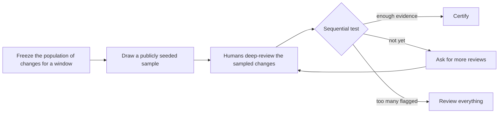

# Intent Statement: pr-rla phases 3–4 design review

## Problem Statement

- AI agents now merge large volumes of code with no recorded human approval: 130,401 of 138,064 Copilot-agent PRs merged in Q3 2026 were not reviewed. [Q1]
- That figure comes from the GitHub search API on 2026-11-02: merged Copilot-agent PRs from 2026-07-01 to 2026-09-30 return 138,064, and adding `review:none` returns 130,401. Both counts are recorded in `pr-rla/docs/design/spec.md` under "Demand evidence". `review:none` is GitHub's own coarse classification; pr-rla computes its own population from review states. [Q7]
- Teams cannot hand-review everything, and they have no way to make a bounded, verifiable statement about what slipped through. [Q1]
- Direct pushes to the default branch have the same problem and are worse, with zero review by definition. [Q1]
- pr-rla answers this with a risk-limiting audit: it freezes the population of changes for a window, draws a publicly seeded sample anyone can re-derive, has humans deep-review only the sample, and runs a sequential test that certifies, asks for more reviews, or says to review everything. [Q1]
- This piece of work reviews and refines the existing phase 3–4 draft design that the two input documents point to, rather than starting from a blank page. [desc] [Q3]

The audit, as the confirmed business context describes it [Q1]:

<!-- Text fallback: the audit freezes the population of changes for a window, draws a publicly seeded sample, and has humans deep-review the sampled changes. A sequential test then either certifies, asks for more reviews (which loops back to human review), or says to review everything. -->

## Target Customer

- Engineering teams letting AI agents merge: they get a bounded, verifiable statement about unreviewed changes without hand-reviewing everything. [Q1]
- Auditors and compliance: SOC 2 change-control audits already sample changes, and agent merges create deviations they must reason about. [Q1]
- Third-party provider authors: they write a provider for their own source code system using only the public SDK. [Q1] [Q2]
- AI-assistant users: they run an audit end to end from an AI assistant. [Q1] [Q2]

## Success Metrics

| Metric | Pass criterion | What this design-only phase does | Source |
|--------|----------------|----------------------------------|--------|
| Third-party provider without core changes | A provider written against only the public SDK passes the conformance kit without touching core code | Already met by the phase 1–2 code; this work reviews that evidence and does not re-prove it | [Q2] [Q4] |
| Three SCMs, one kit | The GitHub, GitLab and Bitbucket providers all pass the same conformance kit; populations include merged PRs/MRs and direct pushes with no double counting | Already met by the phase 1–2 code: the GitHub (including Enterprise), GitLab, Bitbucket Cloud, Bitbucket Data Center and Gitea-example providers all pass the conformance kit (144 tests, per `pr-rla/BUILD-NOTES.md`, Phase 2); this work reviews that evidence and does not re-prove it | [Q2] [Q4] |
| End to end from anywhere | An audit runs end to end from the CLI, from CI, and from an AI assistant via MCP on each of the three SCMs | This work specifies the fixture-based end-to-end test matrix, with named tests and pass criteria; the proof itself happens in the build phase on recorded fixtures and mock servers. Live runs on real repos come later and must be a configuration change, not new code | [Q2] [Q4] |
| Prospective gh-aw certificate | A prospective audit of gh-aw, GitHub's public repo `github/gh-aw` used as the real demo population, produces a certificate about 7 weeks after v0.1 | Enabled by this design, not delivered by it; with no Rekor writes, the registration's timing proof stands on the RFC 3161 timestamp authorities alone | [Q2] [Q4] [Q6] |

## Initiative Trigger

- The volume of unreviewed agent merges, shown by the Q3 2026 Copilot-agent figures. [Q1] [Q7]
- SOC 2 change-control audits already sample changes (25, 40, 60), and agent merges create deviations auditors must reason about. [Q1]
- The founder wants pr-rla public as an open-source project and portfolio piece, with a later paid tier. [Q1]
- It must not be GitHub-only. [Q1]

## Initial Scope Signal

### Workflow-selected scope

- Workflow-selected scope: `mvp`. This is the size of delivery workflow that was chosen, not a product boundary. [scope]

### User-confirmed product boundary

- Review and refine the existing phase 3–4 draft in `pr-rla/docs/design/phase-3-4/` (README and 01–07) and the open questions in phases 1–2, recording per stage what is kept, changed and added, and why. [Q3]
- Look hardest at gaps in requirements and NFRs (security, reliability, operability), unit boundaries and build order, anything marked unverified, and the contracts between units. [Q3]
- Those contracts are the SDK v2 records (the next version of the normalized data types providers return, such as `ChangeRecord`), the broker (the component that makes every outbound HTTP call for plugins, holds the tokens, paces rate limits and enforces read-only access), and the MCP tools. [Q3] [Q6]
- Design only: the work stops before Code Generation. [Q3]
- Fixed and not redesigned: the statistical method and its guarantees, and the phase 2 provider ecosystem, which is reviewed but not redesigned. [Q3]
- The founder's decisions of 2026-11-03 are constraints and win where the draft recommended otherwise. [Q3]
- D3: no writes at all to Sigstore's Rekor, a public and permanent transparency log. [Q3] [Q6]
- D7: no FIDO hardware security key is available, so reviewer presence signatures are tested with software keys only. [Q3] [Q6]
- D8: write paths (issue ledgers, CI, end-to-end runs) are tested only on recorded fixtures and mock servers, with no real scratch repos. [Q3] [Q6]
- Nothing is published to npm, GitHub or any public log without the founder's explicit approval. [Q3]

## Glossary

- **Risk-limiting audit**: a statistical audit that reviews a random sample and either certifies the whole population or asks for more review. [background]
- **SCM**: a source code management system, such as GitHub, GitLab or Bitbucket. [background]
- **Conformance kit**: the test kit a provider runs to show it behaves the way pr-rla expects. [background]
- **MCP**: the Model Context Protocol, which AI assistants use to call a tool's functions. [background]
- **RFC 3161 timestamp authority**: an independent service that signs a timestamp over a hash, proving the hash existed by that time. [background]
- **Rekor**: Sigstore's public and permanent transparency log. [Q6]
- **SDK v2 records**: the next version of the normalized data types providers return (`ChangeRecord` and others). [Q6]
- **The broker**: the component that makes every outbound HTTP call for plugins, holds the tokens, paces rate limits and enforces read-only access. [Q6]
- **gh-aw**: GitHub's public repo `github/gh-aw`, the real population used for the demo audit. [Q6]

## Assumptions & Open Questions

None.
