# Scope Document: pr-rla phases 3–4 design review

## Inputs

- The approved intent: `ideation/intent-capture/intent-statement.md` (business context, success metrics, boundary).
- The approved feasibility work: `ideation/feasibility/feasibility-assessment.md`, `constraint-register.md` and `raid-log.md`.
- This stage's answers: `scope-definition-questions.md` Q1–Q3.
- The draft's units: `pr-rla/docs/design/phase-3-4/04-units-of-work.md`.

## The boundary

### In scope

- The design of all eleven draft units (U1, U2a, U2b, U3–U10), refined stage by stage, recording what is kept, changed and added (Q1; intent statement).
- All eleven are built in this round, locally, before the first public release. That now includes U8, the org-pooled freeze, which is no longer deferred to v0.2 (Q1). The vision's label for it has been updated at the founder's request.
- The five open design questions from the vision: tamper-proof registration time, plugin trust, the MCP surface, issue-tracker ledgers and the org-pooled freeze (intent statement).
- The phase 1–2 open questions answered in the draft's `02` (intent statement).
- The test design for every unit, including the fixture-based end-to-end matrix that metric 3 needs (intent Q4).

### Out of scope

- Code generation and the build itself: this work stops before Code Generation (intent Q3; constraint FC-21).
- Redesigning the statistical method, the seed derivation or the seven `verify` checks (FC-01 to FC-03).
- Redesigning the phase 2 provider ecosystem, which is reviewed only (FC-07).
- Any public or permanent write: npm publishing, creating the public GitHub repo, Rekor entries of any kind, including staging (FC-15, FC-16).
- Live write tests and scratch repos; write paths are designed for fixtures and mock servers only (FC-17).
- Testing presence attestation with a real FIDO key (FC-14).
- The later paid tier: hosted planted-bug calibration, org dashboards and evidence packs (vision, business drivers).
- A hosted backend of any kind (FC-08).
- **Assumption:** built-in providers for Azure DevOps and internal SCMs. The vision names them among the systems teams use but lists only GitHub, GitLab and Bitbucket as built-ins; those SCMs are reached through the public provider SDK.

## Value stream

How the in-scope units turn an unreviewed change into evidence an auditor can check:

```mermaid
flowchart LR
    A["Changes reach the default branch unreviewed"] --> B["Register the audit, time-stamped (U1)"]
    B --> C["Freeze the population on any SCM, or across an org (U2a, U3, U8)"]
    C --> D["Draw a public, re-derivable sample"]
    D --> E["A human reviews each draw from the CLI, an AI assistant or the web (U5, U6)"]
    E --> F["The verdict is recorded in the team's ledger (U4, U9)"]
    F --> G["Status and certificate, also from CI (U5, U7)"]
    G --> H["Anyone re-runs verify (U1, U2b, U4)"]
    H --> I["Auditor accepts the certificate as change-control evidence"]
```

<!-- Text fallback: changes reach the default branch unreviewed; the audit is registered with a timestamp (U1); the population is frozen on any SCM or across an org (U2a, U3, U8); a public, re-derivable sample is drawn; a human reviews each draw from the CLI, an AI assistant or the web (U5, U6); the verdict is recorded in the team's ledger (U4, U9); status and the certificate are produced, also from CI (U5, U7); anyone re-runs verify (U1, U2b, U4); and the auditor accepts the certificate as change-control evidence. U10 (docs and release engineering) supports every step. -->

## Minimum viable scope

The founder's choice is that the first public release carries every Must and Should unit (Q2): U1, U2a, U2b, U3, U4, U5, U6, U7 and U10 as Must, and U8 as Should, built after the Musts. U9 is Could: with no FIDO key it is built and tested with software keys only (D7), so it cannot prove presence. The detail is in `intent-backlog.md`.

## Sequencing

Risk-first, as the feasibility assessment recommends: **U1 → U2a → U4 → U2b → U3 → U5 → U7 → U6 → U8 → U9 → U10** (Q3).

- It respects every edge of the draft's dependency graph. U3 needs to come before U5 and U8 only, and it does, so U3 did not have to move.
- U4 moves ahead so the unverified label-event behaviour (RK-03) is settled before CI and assistant work depend on issue ledgers.
- U2b moves ahead so the plugin isolation limits (RK-02) are known before U8 runs pooled freezes through plugins.
- There is no hard deadline (feasibility Q2). U1 stays first because the gh-aw timing proof stands on it.

## Review record: what this stage kept, changed and added

- **Kept.** The draft's eleven units, their dependency graph, and their split into phase 3 and phase 4 as labels.
- **Changed.**
  - U8 moves from "v0.2" to this round, before release (Q1). This supersedes the feasibility assessment's "stays v0.2" and RK-07's response.
  - U6 is Must, not Should, because the founder wants pr-rla used from Claude Code and other assistants, which needs the plugin, the skill and the guides (Q2).
  - The build order is risk-first instead of the draft's (Q3).
- **Added.** An explicit in/out boundary, a minimum viable scope, the value stream, and the MoSCoW ranking. The draft has no scope stage.
- **To change in later stages.** The draft's unit acceptance criteria that conflict with the founder's decisions: U1's live Rekor work (D3), U7's scratch-repo and `act` runs (D8), and U9's hardware-key fixtures (D7).
