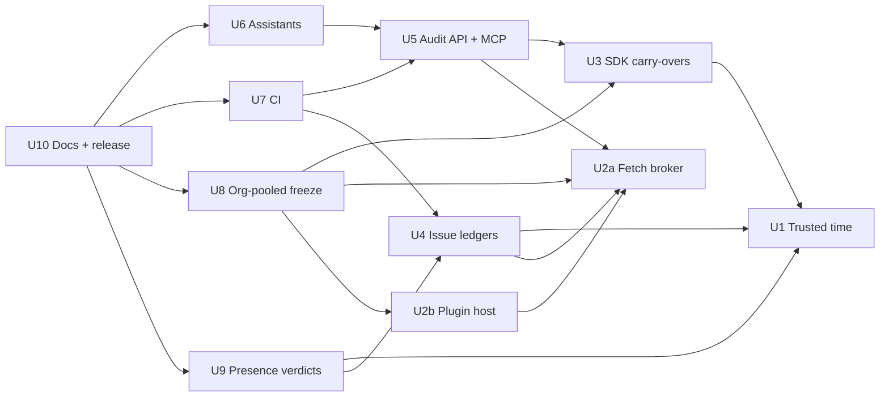

# Unit Dependencies: pr-rla phases 3–4

**Stage:** Units Generation. Topology only: what depends on what. The build order the founder chose is in `delivery-plan.md`.

## Dependency graph



<!-- Text fallback: arrows point from a unit to what it depends on. U3 depends on U1. U4 depends on U1 and U2a. U2b depends on U2a. U5 depends on U3 and U2a. U6 depends on U5. U7 depends on U5 and U4. U8 depends on U3, U2a and U2b. U9 depends on U1 and U4. U10 depends on U6, U7, U8 and U9. U1 and U2a depend on no unit. -->

```yaml
units:
  - name: u1-trusted-time
    kind: library
    depends_on: []
  - name: u2a-fetch-broker
    kind: library
    depends_on: []
  - name: u2b-plugin-host
    kind: library
    depends_on: [u2a-fetch-broker]
  - name: u3-sdk-carry-overs
    kind: library
    depends_on: [u1-trusted-time]
  - name: u4-issue-ledgers
    kind: library
    depends_on: [u1-trusted-time, u2a-fetch-broker]
  - name: u5-audit-api-mcp
    kind: service
    depends_on: [u3-sdk-carry-overs, u2a-fetch-broker]
  - name: u6-assistant-integrations
    kind: packaging
    depends_on: [u5-audit-api-mcp]
  - name: u7-ci-integrations
    kind: packaging
    depends_on: [u5-audit-api-mcp, u4-issue-ledgers]
  - name: u8-org-pooled-freeze
    kind: library
    depends_on: [u3-sdk-carry-overs, u2a-fetch-broker, u2b-plugin-host]
  - name: u9-presence-verdicts
    kind: library
    depends_on: [u1-trusted-time, u4-issue-ledgers]
  - name: u10-docs-release
    kind: packaging
    depends_on: [u6-assistant-integrations, u7-ci-integrations, u8-org-pooled-freeze, u9-presence-verdicts]
```

The graph is acyclic. U1 and U2a are the only roots.

## Why each edge exists

| Edge | Reason |
|------|--------|
| U3 → U1 | U1 defines record schema v2 in full; U3 fills its selector and manifest fields (`bots`, `direct_push_via_merge`, `headSha`, `reviewGranularity`) |
| U4 → U1 | Checkpoints are time-stamped with U1's tokens; ledger history feeds check 7 under schema v2 |
| U4 → U2a | Issue ledgers fetch through the broker and are wrapped by its read-only guard in MCP mode |
| U2b → U2a | The host's child process fetches over IPC through the broker, which swaps credential placeholders |
| U5 → U3 | `draw_context` needs `describeChange` and `Actor.id`; the API reports pinned heads |
| U5 → U2a | The MCP server's guarantee rests on the broker's read-only guard |
| U6 → U5 | The plugin launches `pr-rla-mcp` and the skill calls its tools |
| U7 → U5 | CI runs the API-backed CLI with `--json` |
| U7 → U4 | The GitHub and GitLab CI paths run on verdict-label events and append checkpoints |
| U8 → U3 | Pooled freezes need pinned heads per repo and `listRepos` |
| U8 → U2a | One per-host budget across many repos |
| U8 → U2b | Pooled freezes through external providers run them in the host |
| U9 → U1 | Signed verdicts enter check 7 under schema v2 `verdicts.reviewers` |
| U9 → U4 | Provenance levels and `minProvenance` are shared with the issue ledgers' `account` level |
| U10 → U6, U7, U8, U9 | Docs describe finished behaviour; the release checks cover every package |

**Edges that are deliberately absent:**
- **U1 → U2a.** U1 binds to the broker contract (`contracts.md` §2) through a minimal adapter until U2a lands.
- **U4 → U3.** U4 matches reviewers by login and gains `Actor.id` matching once U3 lands. Neither blocks the other.

## Integration points

| Between | Integration | Contract |
|---------|-------------|----------|
| Providers and ledgers ↔ core | Typed SDK, in process or over IPC | `contracts.md` §1 |
| Every network caller ↔ FetchBroker | `ctx.fetch` with a plugin id and a destination class | `contracts.md` §2 |
| PluginRegistry ↔ PluginHost child | Line-delimited JSON over the Node IPC channel | `contracts.md` §3 |
| McpServer ↔ AuditApi | Function calls in read-only mode; structured results | `contracts.md` §4 |
| AuditApi ↔ audit directory | Record schemas v2 and the lock file | `contracts.md` §5 |
| Checkpoint writer ↔ audit repo | Git transport | `contracts.md` §6 |
| CLI ↔ CI and users | Exit codes and `--json` outputs | `contracts.md` §7 |

## Parallel development opportunities

Units with no path between them can be built at the same time:
- U1 and U2a (both roots).
- After U1 and U2a: U2b, U3 and U4.
- After U5: U6 and U7, once U4 is also done.
- U8 and U9 are independent of each other.

The founder chose a single serial, risk-first order (`delivery-plan.md`), which is one valid topological ordering of this graph.
