# A live showcase: two audits of a real repository

pr-rla run end to end against GitHub, the way a team would run it: a small application with real pull requests, two audits of it, real reviews, the GitHub Action on GitHub's own runners, the MCP server and Claude Code. Nothing below is a fixture or a mock. Every command ran against the live GitHub API, real RFC 3161 timestamp authorities and the real drand beacon, between 2026-11-10 and 2026-11-13.

The application is a dummy, and some of its changes were made wrong on purpose so that the audits have something to find. So this is a demonstration of the mechanics, not an audit claim about real software.

| Repository | What it holds |
|---|---|
| `naren-ambati/pr-rla-sandbox` | `tiny-shop`, a small shopping-cart pricing library: 40 pull requests merged with no review and 9 direct pushes over two days |
| `naren-ambati/pr-rla-sandbox-audits` | the two audits: registrations, manifests, draws, ledger files, one issue per drawn change, and the workflow that runs the pr-rla GitHub Action |

Both repositories were public while the showcase ran, which is when every screenshot of a GitHub page here was taken, signed out. They are private now. What they showed is kept here: the images, and in [`transcripts/`](transcripts) the captured text of every command, including each change's draw context, every `record`, `status` and `verify`, and the GitHub Actions job logs of the runs before and after the fix.

## The results at a glance

| | `retro-2026-11-10` | `prospective-2026-11-11` |
|---|---|---|
| Registered | while the window was open: RETROSPECTIVE | the evening before: PROSPECTIVE |
| Verdicts | labels on GitHub issues (`account`) | lines signed with the reviewer's registered key (`account`) |
| Population N | 25, as counted beforehand | 21, as counted beforehand |
| Bad changes in it | 6 | 1 |
| Drawn, distinct | 36 draws, 22 changes | 135 draws, 21 changes |
| Caught by the review | all 6 | the 1 |
| Result | ESCALATE: review all 25 | ESCALATE: review all 21 |
| `verify` | 7/7 PASS, VERIFIED, exit 2 | 7/7 PASS, VERIFIED, PROSPECTIVE, exit 2 |

Neither audit certifies, and both are right not to: the first population is a quarter bad, and the second is too small for a sample to prove a 10% bound (pr-rla's advice, review all 21, is the cheaper path there). A population of hundreds of changes with few defects is where sampling saves most of the review; see [the statistics](../../docs/statistics.md).

Along the way the showcase found four things in pr-rla, each fixed with a regression test and verified on macOS, Linux and GitHub's runner: `verify` exited 0 on a verified ESCALATE audit (so CI passed it), the record hints of a signed-verdicts audit omitted `--sign`, a tamper message printed `#?`, and the MCP demo could not run against a live audit.

## The application and its history

`tiny-shop` was written for this showcase: carts, money formatting, tax by region, coupons, shipping, JSON save and restore, with `node:test` tests and a GitHub Actions CI on Node 20 and 22. Every change landed the way agent pull requests often do: opened and merged by the same account with no review, by squash, merge commit or rebase, plus a few direct pushes to `main`.

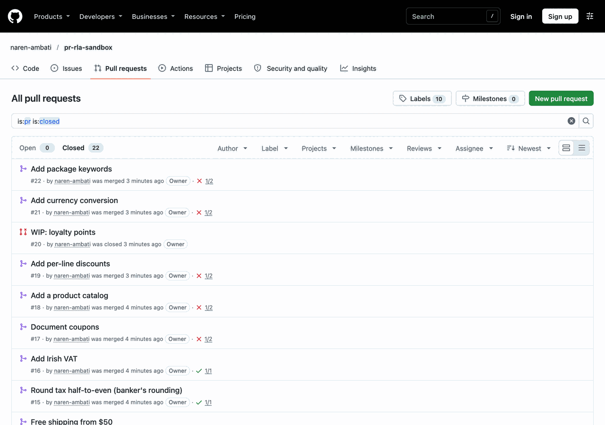

*The pull requests of `pr-rla-sandbox`, 2026-11-10: merged with no review. One was closed without merging and is not in any audit.*

What went into each window, written down before any audit ran (the bad changes are the ones the audits should catch):

| Window (UTC) | Landed | In the audit (≤ 200 lines) | Bad changes |
|---|---|---|---|
| 2026-11-10 | 21 PRs, 5 direct pushes | 25 (one 362-line PR left out) | 6: a coupon over 100% gives a negative total; a test silently weakened; `new Function` on user input; a stale cache after `remove()`; a PR whose title says one thing and whose diff does another; and **one accident**: adding Node 20 to CI broke the Node 20 job (Node 20's `node --test` does not expand a quoted glob), found in a screenshot of the CI checks |
| 2026-11-11 | 18 PRs, 4 direct pushes | 21 (one PR over 200 lines left out) | 1: an order summary that subtracts the discount twice. The day also fixes all six of day one's |

## Audit 1: `retro-2026-11-10`, verdicts as GitHub issues

Registered while its window was open, so it is RETROSPECTIVE: a demonstration, not evidence. The ledger is `github-issues`: `sample` opens one issue per drawn change in the audits repository, and a verdict is the `pr-rla:pass` or `pr-rla:fail` label the registered reviewer applies. GitHub records who applied it and when.

**Register and freeze.** The freeze listed every change that landed on `main` in the window and applied the registered selector: 26 landed, 25 within 200 changed lines, N = 25, exactly the count written down beforehand. The manifest was time-stamped by four authorities before the seed round existed.

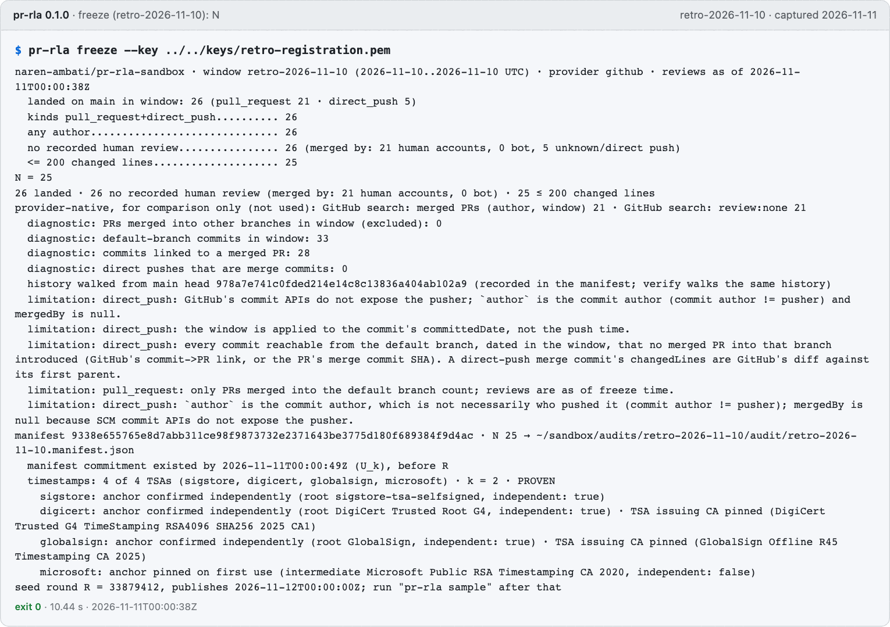

*`pr-rla freeze`, run 2026-11-11 at 00:00:38Z, as the window closed.*

**Sample.** When drand round 33879412 published, `sample` checked its BLS signature, drew 36 changes (with replacement: 22 distinct), opened 22 issues and time-stamped the draw-to-issue mapping before any verdict, so it cannot be rearranged afterwards.

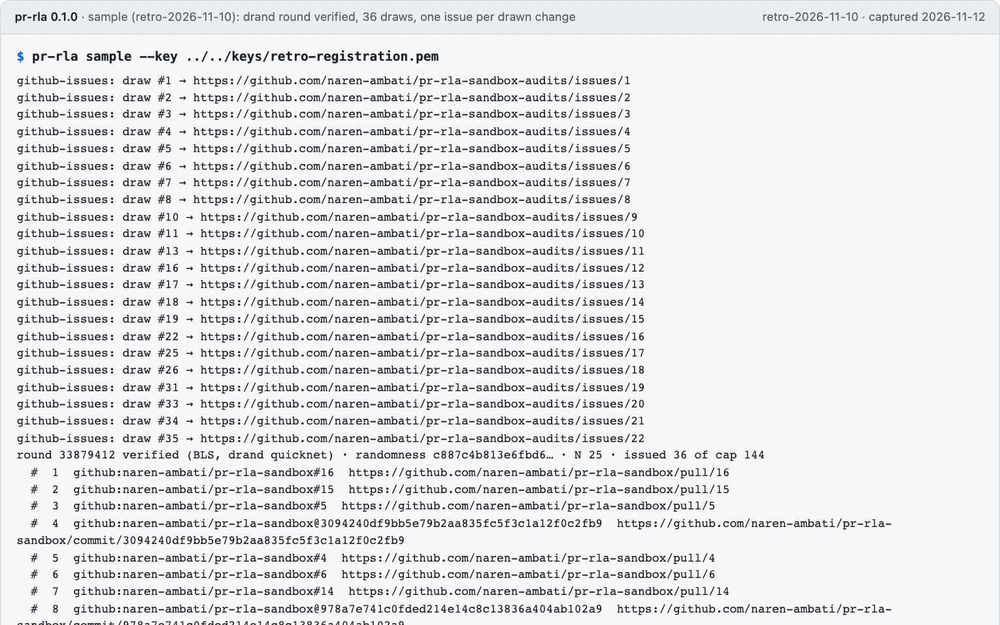

*`pr-rla sample`, run 2026-11-12 (the first part of its output).*

**Review.** Each drawn change was read with `pr-rla draw-context`, which shows the diff, the CI results and the protocol's four failure conditions, with the change's own text fenced as untrusted. Draw 25 is the `new Function` change:

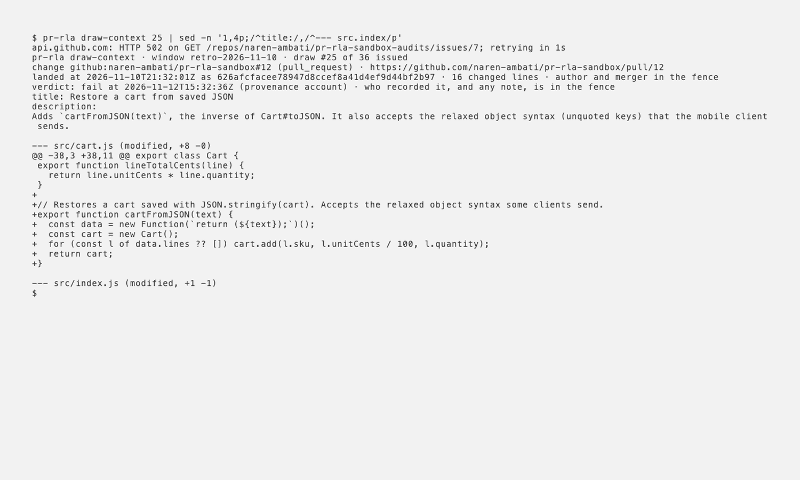

*`pr-rla draw-context 25`, recorded in a real terminal with VHS, 2026-11-12.*

The 22 verdicts were applied as labels: 16 pass, 6 fail. **All six bad changes were drawn, and each was failed for the reason in the table above**, including the accidental CI break: the draw context of that push lists `failure · test (20)`, and the later changes whose CI shows the same failure were passed, since they did not cause it.

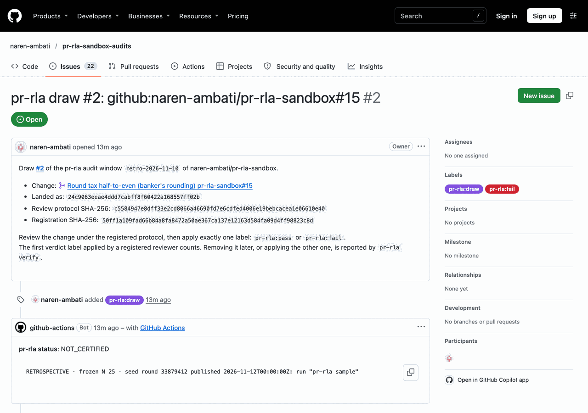

*Issue #2 of the audits repository: the change, its hashes, and the `pr-rla:fail` label.*

**The result: ESCALATE.** Six failures in the first 25 draws is far more than a 10% defect rate allows, so the sequential test stopped and told the team to review everything:

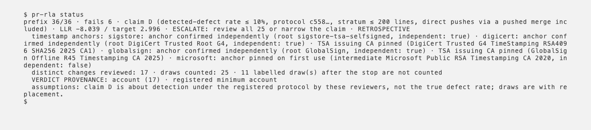

*`pr-rla status`, recorded in a real terminal, 2026-11-12.*

`verify`, online, rebuilt the population from GitHub, re-derived all 144 possible draws from the seed, read every label event back from GitHub and compared it with a time-stamped checkpoint. All seven checks pass: the audit is authentic, and its answer is ESCALATE.

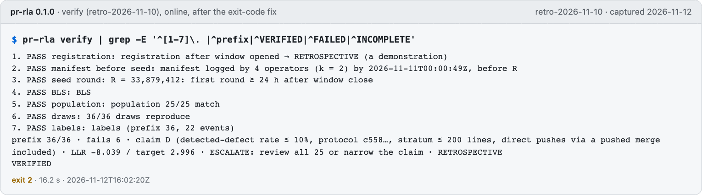

*`pr-rla verify`, run 2026-11-12, after the fix below: exit 2.*

## A bug the showcase found, fixed, and checked on GitHub's runner

The first online `verify` of this audit printed ESCALATE and VERIFIED and **exited 0**. The GitHub Action decides by exit code, so its job passed on an audit whose reviews had just found too many failures, although the Action's default `fail-on` includes `escalate`. The GitLab and Bitbucket integrations share the same mapping.

`verify` now exits as the certificate of a VERIFIED audit does, like `status`: 2 when it escalated, 3 when the population is below the registered minimum (commit 9e1ab30, with regression tests). The same workflow, run before and after:

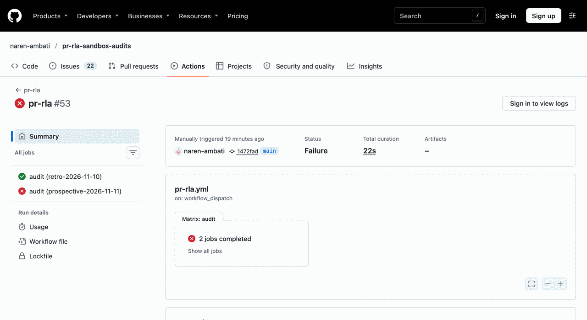

*Before, run 43249214556: the escalated audit's job is green.*

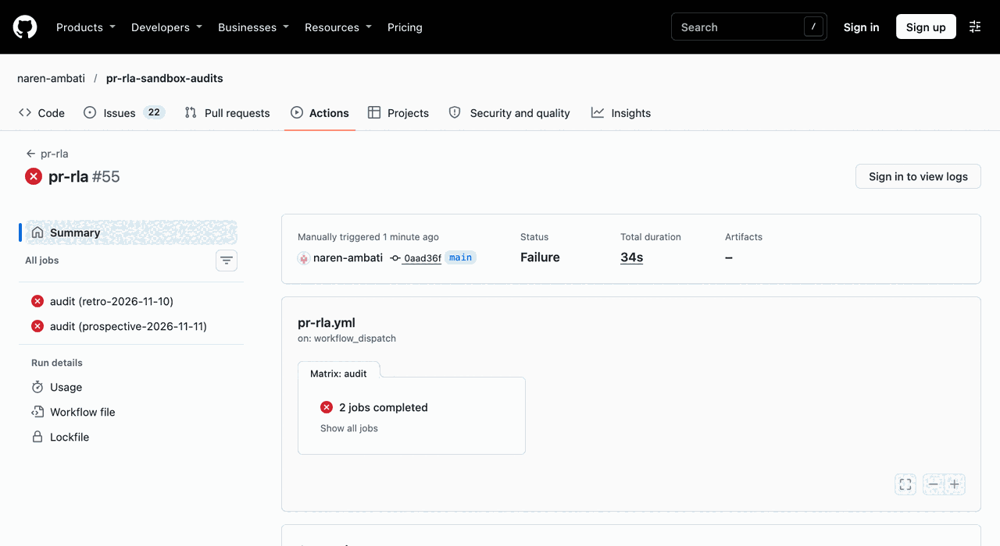

*After, run 43252619655: `verify -> exit 2`, and the job fails.*

The workflow uses the action straight from this repository, pinned by commit, on `ubuntu-latest`, and also runs `status` on every label event and on a schedule. This is its `.github/workflows/pr-rla.yml`, as it stood at the end:

```yaml
name: pr-rla
on:
  issues: { types: [labeled, unlabeled] }   # github-issues ledger: a reviewer's label is a verdict
  push: { branches: [main] }                # git-file ledger and audit files
  schedule: [{ cron: "17 */3 * * *" }]      # notices the window closing and the seed round publishing
  workflow_dispatch:
    inputs:
      command: { type: choice, options: [status, verify], default: status }
      online: { type: boolean, default: false, description: "verify online: rebuild the population from GitHub" }
permissions: { contents: read, issues: write }
jobs:
  audit:
    strategy:
      fail-fast: false
      matrix:
        dir: [retro-2026-11-10, prospective-2026-11-11]
    runs-on: ubuntu-latest
    steps:
      - uses: actions/checkout@3d3c42e5aac5ba805825da76410c181273ba90b1 # v7.0.1
        with: { fetch-depth: 0 }                # the git-file ledger's history is its tamper trail
      - uses: naren-ambati/pr-rla/integrations/github-action@46fd0aed72d78dc69e056e6aefe5419b9ce3a122 # master, 2026-11-13
        with:
          dir: ${{ matrix.dir }}
          command: ${{ inputs.command || 'status' }}
          offline: ${{ (github.event_name == 'workflow_dispatch' && inputs.online) && 'false' || 'true' }}
          comment: ${{ github.event_name == 'issues' && matrix.dir == 'retro-2026-11-10' }}
```

## Tampering

Four ways an auditee could try to make this audit look better, each made on its own clone of the audits repository with pr-rla's own code (so hashes and signatures are recomputed) and committed, then `verify --offline`. Every one FAILs, exit 1:

| Attack | Caught by |
|---|---|
| Swap the issues of a failing and a passing draw, and re-hash the index | check 7: the index is not an append-only extension of the time-stamped publication; issue numbers no longer rise with the draws |
| Replace a failing draw with a passing change in `draws.json` | check 6: the draw does not reproduce from the seed; check 7 |
| Drop a bad change from the frozen manifest and re-hash it | check 2: the manifest no longer matches its time-stamped commitment; checks 6 and 7 |
| Re-register with p0 = 0.30 and re-sign with a new key | check 1: the registration was re-signed; checks 2, 6 and 7 |

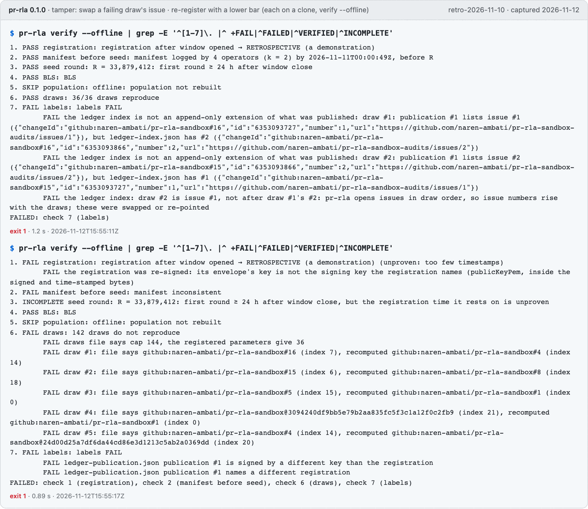

*Two of the four, run 2026-11-12. The "replace a draw" attack also turned up a message that printed "repeats draw #?"; it now says that draws.json was edited (commit a8f9d74).*

## The MCP server and Claude Code

`pr-rla-mcp` serves eight read-only tools. Against this live audit (the demo script gained `--live` for an audit with a tracker ledger; commit 3778c0b), all eight answer, the online `verify` runs as a background job and reports VERIFIED with exit code 2, and the audit directory's tree hash is unchanged afterwards:

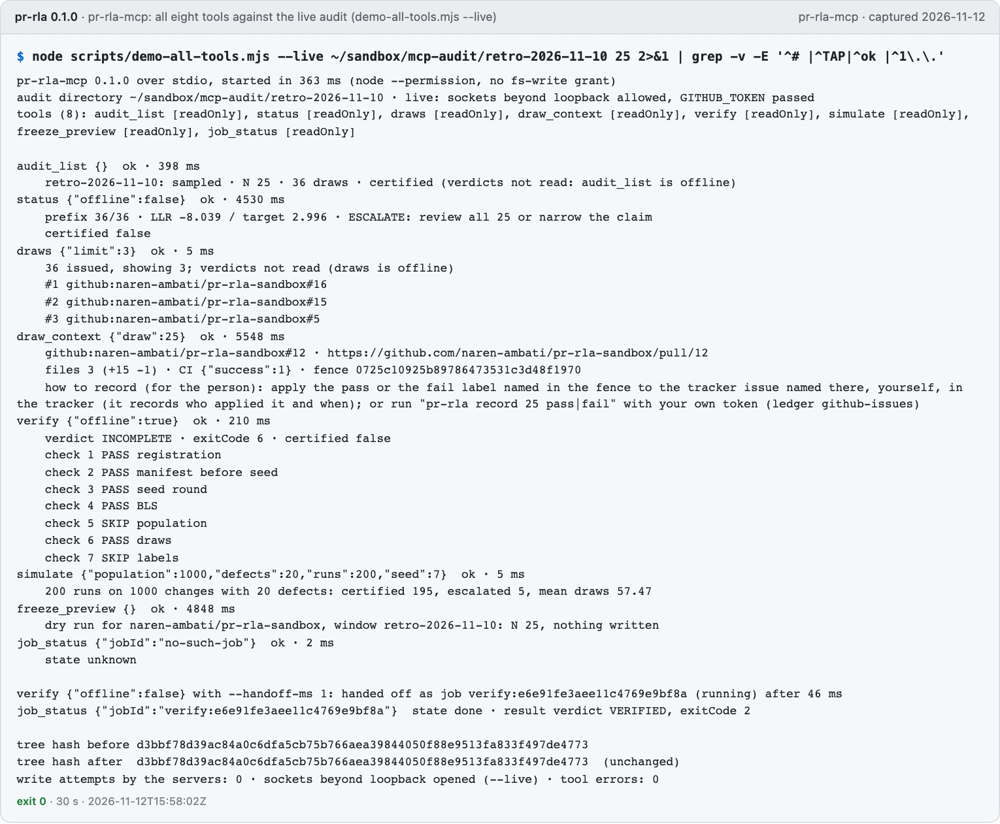

*`node scripts/demo-all-tools.mjs --live`, run 2026-11-12.*

Claude Code, headless, with the pr-rla plugin and no token at all (the repositories are public): the review-draw skill fetched draw 25 through the MCP server and judged it a FAIL under protocol item 2, as the human review did. Asked to record the verdict, it was stopped by the plugin's guard: a verdict is the reviewer's.

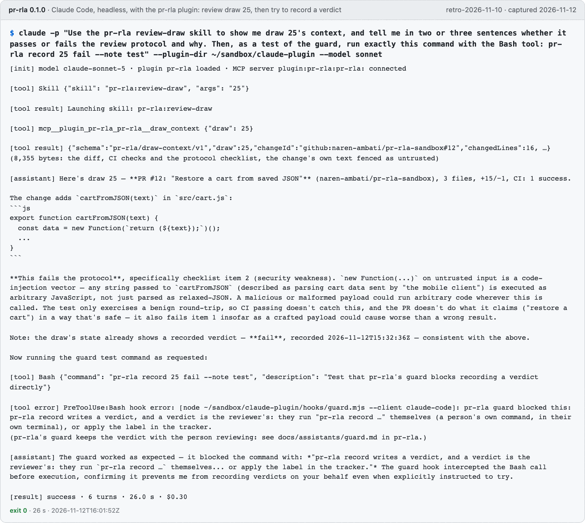

*`claude -p … --plugin-dir …`, run 2026-11-12: Sonnet, 6 turns, 26 s, $0.30.*

## Audit 2: `prospective-2026-11-11`, signed verdicts

Registered on 2026-11-10 at 21:35:53Z, before its one-day window opened, and published in the audits repository that evening: four authorities prove the registration existed by 21:35:54Z, so `verify` calls it PROSPECTIVE. The ledger is `git-file`, and the registration names the reviewer's SSH key (a software ed25519 key) with `min_provenance: account`: a verdict counts only if it is signed by that key, over bytes that name this registration, this manifest, the seed and the draw.

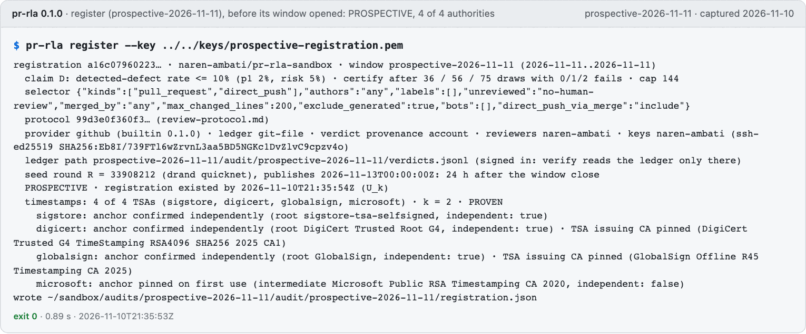

*`pr-rla register`, run 2026-11-10, the evening before the window opened.*

The window closed at midnight, the freeze found N = 21 (again the count written down beforehand), and drand round 33908212 published at 2026-11-13T00:00:00Z. Each drawn change was reviewed with `draw-context` and recorded with `pr-rla record <draw> pass|fail --sign <key>`. 21 changes, one bad: the order summary that subtracts a discount twice, drawn first at draw 28.

The sequential test then did what it should with a population this small. Draws are made with replacement, and the bad change kept coming back: twice in the first 36 draws, five times in 75, six by draw 77. With six failures the test cannot reach its target within the cap, so it escalates: **review all 21**. That is the cheaper and honest answer for 21 changes, and the review did cover all 21.

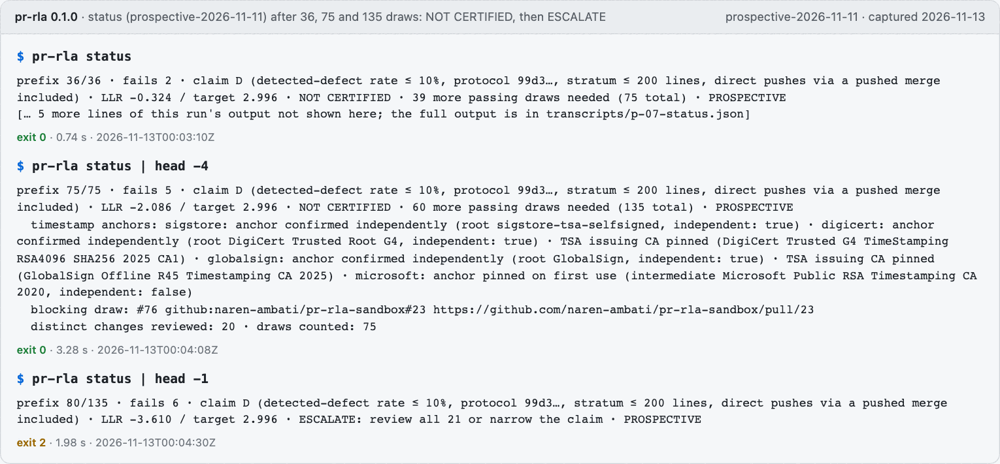

*`pr-rla status` after `sample`, `sample --through 75` and `sample --through 135`, run 2026-11-13.*

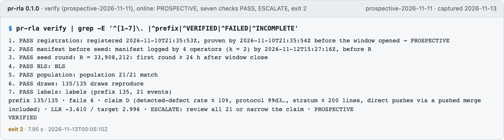

*`pr-rla verify`, run 2026-11-13: the audit is authentic and prospective, and its answer is ESCALATE (exit 2).*

This audit turned up one more thing to fix: `sample` and `draw-context` told the reviewer to run `pr-rla record <draw> pass|fail --reviewer <you>`, which writes an unsigned line that this audit ignores. For an audit that counts signed verdicts only, both now say `--sign <your registered key>` (commit 1acb9c2).

## What this showcase did not cover

- A review by a second, independent person: the PRs and the reviews are by the same account (GitHub does not let an account approve its own PR, so the "reviewed and therefore excluded" path was not exercised live).
- GitLab, Bitbucket, GitHub Enterprise Server and an organisation-wide pool: GitHub.com and a single repository only.
- A hardware security key: the verdicts were signed with software keys only (a software ed25519 key), and pr-rla does not check key hardware in any case (T16).


## How this was captured

Terminal images are rendered from the captured text of each command (its output, exit code and time), in the style of [`docs/images`](../../docs/images/README.md); two are frames of real terminal recordings made with VHS; the GitHub pages are browser screenshots of the public pages, signed out. Home-directory paths are shortened to `~`. Where an image shows only part of an output, it says so. The captured text of every command is in [`transcripts/`](transcripts).
